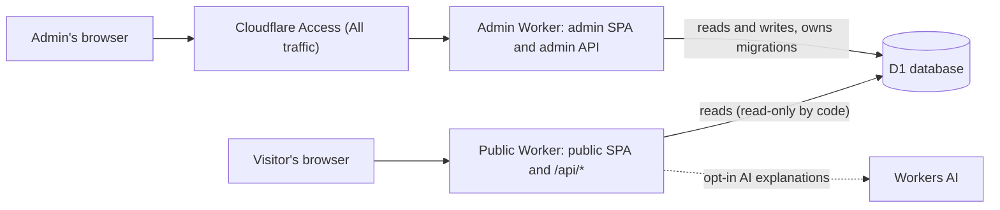
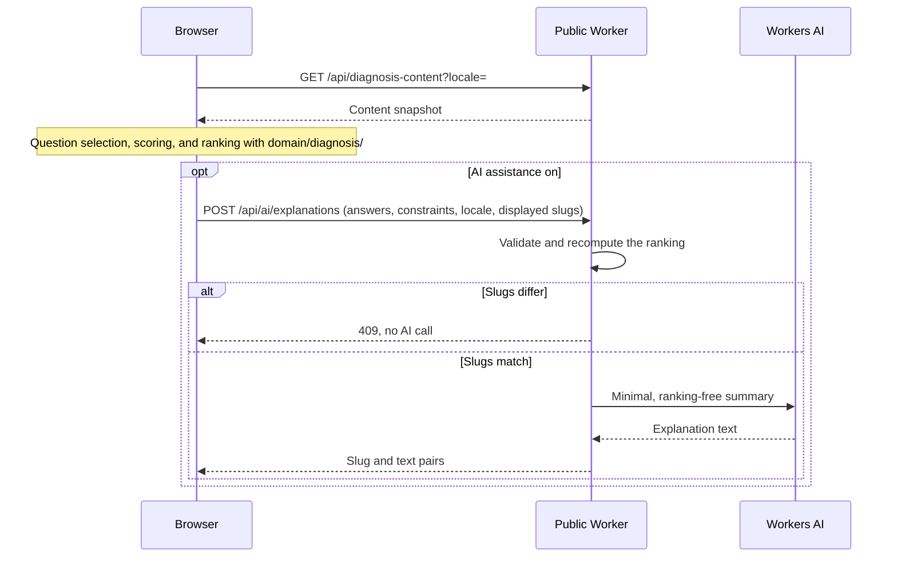

English | [日本語](../ja/ARCHITECTURE.md) · [Docs index](README.md)

# Architecture — Travel Discovery

Travel Discovery runs as two Cloudflare Workers, a public one and an Access-protected admin one, that share one D1 database. This page describes the Workers, the logical layers, the request flows, admin authentication, the AI boundary, and privacy. It is for contributors who change code across these boundaries; the source layout is in [DEVELOPMENT.md](DEVELOPMENT.md) ("Project layout").

## 1. Architecture overview

Two Cloudflare Workers share one D1 database (decisions: [DECISIONS.md](../working/DECISIONS.md) ADR-001, ADR-004, ADR-018).

| Worker | Serves | Access protection | D1 usage |
|---|---|---|---|
| Public Worker | Public SPA (static assets), the public read API under `/api/*`, and the opt-in AI explanation endpoint (Phase 4, ADR-026) | None (public site) | Read-only **by code structure and tests only** (no DB-level permission) |
| Admin Worker | Admin SPA (static assets) and the admin API | Worker-level Cloudflare Access ("All traffic") on every URL, plus JWT validation in every admin API handler | Reads and writes; owns migrations |

Both are TypeScript + React + Vite apps built with Cloudflare's Vite plugin. They build from separate configs (`vite.config.ts` + `wrangler.jsonc`, `vite.admin.config.ts` + `wrangler.admin.jsonc`) into separate outputs (`dist/`, `dist-admin/`). The public Worker contains no admin editing functions. The source layout and the module boundaries are listed in [DEVELOPMENT.md](DEVELOPMENT.md) ("Project layout").

Components:
- React + TypeScript + Vite.
- React Router (data mode) for routing in each SPA.
- i18next + react-i18next with typed message catalogs for `ja`, `en`, `es`, and `fr` (ADR-012, ADR-032).
- Tailwind CSS and shadcn/ui for UI.
- Motion for React for restrained transitions.
- Cloudflare Workers for API endpoints and server-side logic.
- Cloudflare D1 for content data.
- Drizzle ORM 0.45.x (stable line) for schema and queries; SQL migrations applied with Wrangler (ADR-003).
- Zod for runtime input/output validation.
- Workers AI as an optional provider behind a small adapter interface.
- Vitest for unit/integration tests; Playwright for E2E.
- GitHub Actions for lint, type-check, tests, and build.

Do not assume versions or compatibility from memory. Check current official docs before scaffolding and record decisions in [DECISIONS.md](../working/DECISIONS.md).

## 2. Logical layers

### UI
- Public landing page.
- Quiz flow.
- Results page.
- Admin console (served only by the admin Worker), localized in Japanese, English, Spanish, and French.
- AI assistance toggle and non-blocking availability/error messages.

### Domain logic (pure TypeScript)
- Question candidate selection.
- Adaptive next-question selection.
- Answer validation.
- Destination hard filtering and preference scoring.
- Ranking, normalization, and deterministic tie-breaking.
- Fallback explanation generation.

Domain logic must not import React, Cloudflare bindings, database clients, or AI SDKs. It should be testable without network or database access.

### Application/services
- Read active questions and destinations.
- Apply quiz and recommendation use cases.
- Handle AI explanation request only when explicitly enabled.
- Validate all external inputs and model outputs.

### Data access
- D1 repository/query layer, split into a shared read module (used by both Workers) and an admin-only write module.
- Drizzle schema; migrations owned by the admin Worker configuration.
- Seed scripts/data.
- Never expose direct DB access to the browser.

### Infrastructure
- Worker routes and middleware.
- Admin access control (admin Worker only): Access JWT validation middleware.
- AI provider adapter.
- Rate limiting and safe error handling.
- Deployment configuration.

## 3. Request flow

### Diagnosis
Scoring runs in the browser ([DECISIONS.md](../working/DECISIONS.md) ADR-022). The server only serves content and, when the user opts in, AI notes.

1. **Load content.** When the user starts a quiz, the client loads one content snapshot from `GET /api/diagnosis-content?locale=` (published content, scoring data, quiz settings). The response is not cached by HTTP; the client reuses it in memory for up to 5 minutes.
2. **Keep state in memory.** The client keeps trip constraints, answers, and the seed in memory only. Nothing is stored on the server, and a reload restarts the quiz. With AI assistance off, nothing is sent to the server either; with it on, see step 4.
3. **Rank in the browser.** The client runs question selection, scoring, and ranking with `domain/diagnosis/` ([DIAGNOSTIC_ALGORITHM.md](DIAGNOSTIC_ALGORITHM.md)). It renders results with the deterministic explanation. The results page also shows a world map: the static `/world-map.svg` asset, which the browser fetches only then, with pins placed by `shared/map-projection.ts` (ADR-036). The map makes no external request.
4. **Optional AI notes** (Phase 4, ADR-026, proposed). If AI assistance is enabled, the client sends one `POST /api/ai/explanations` request with the answers, constraints, locale, and the slugs it displays.
   - The Worker validates them and recomputes the ranking from current published content with the same domain module.
   - If the slugs differ, it returns `409` without calling AI.
   - Otherwise it sends a minimal, ranking-free summary to Workers AI and returns `{ slug, text }` pairs for those destinations only.
   - It never trusts a client-supplied ranking and stores nothing.
5. **Show explanations.** If AI is off or fails, the deterministic explanation is shown on its own. When AI succeeds, its text is an additional, labelled paragraph next to the deterministic explanation.

Do not persist individual answer histories in D1.

### Admin
1. Admin opens the admin Worker's URL. Cloudflare Access (Worker-level, "All traffic") requires login before any request reaches the Worker, for every hostname of that Worker.
2. Every admin API request is authorized again inside the Worker by validating the `Cf-Access-Jwt-Assertion` JWT (signature, issuer, audience). Failure or missing configuration → 403.
3. API validates payloads and writes to D1.
4. Changes become visible to public endpoints only after successful validation/publication (`status = 'published'`).

## 4. Admin authentication

Decision (owner-approved, ADR-004): a separate admin Worker protected by Worker-level Cloudflare Access, with JWT validation in every admin API handler.

- Worker-level Access covers all of the admin Worker's URLs (`workers.dev`, Version URLs, routes, Custom Domains). So there is no unprotected alternate URL to that Worker. Do not add hostname/path Access apps with Bypass policies that match admin hostnames.
- Workers with static assets do not receive `ctx.access`. So the admin API validates the JWT itself (`jose`, team JWKS, issuer, AUD) and fails closed.
- The public Worker has no admin routes or write code, so misconfiguring the public side cannot expose admin functions.
- Do not create a homemade password system.
- [DECISIONS.md](../working/DECISIONS.md) ("Admin authentication status") tracks what is implemented, what is tested, and what can only be verified after an approved deployment.

## 5. AI provider boundary

The AI provider sits behind a small interface, e.g. `RecommendationExplanationProvider`. Its method accepts validated destination content and a compact preference summary and returns validated explanation data.

The domain scoring engine must not depend on this interface. The Workers AI adapter is optional and replaceable. Include:
- input length limits,
- output schema validation,
- timeout/error handling appropriate to the platform,
- request budget/rate limit,
- safe fallback,
- no raw secrets or unnecessary personal data in prompts/logs.

Do not treat destination descriptions or user input as trusted instructions. Keep the prompt explicit that the model is an editor/explainer, not a ranking engine or factual source.

Phase 4 design (ADR-026, proposed):
- **Modules.** `server/ai/` holds the interface, the Workers AI adapter, the prompt builder, and output validation. `server/public/ai-explanations.ts` holds the use case. The domain gains only a pure preference-summary function.
- **What the model sees.** Opaque IDs (`d1`, …) in slug order; never slugs, ranks, scores, costs, or user answers. The server maps IDs back to slugs.
- **Output checks.** Shape, ID set, length, digits/URLs/markup, and script are auxiliary guards. They cannot prove the text is factually correct. Ranking and factual fields stay with the deterministic engine and authored content.
- **Usage bounds.** There is no app-wide daily budget in the MVP. Usage is bounded by:
  - a kill switch (`AI_ASSIST_ENABLED`);
  - a burst rate limiter (Rate Limiting binding, best effort);
  - a strict per-client quota in a Durable Object (5 per 60 s and 30 per UTC day per address, ADR-029);
  - the Workers AI daily allocation.
- **Status and limits in the UI** (Phase 14, ADR-026 "Phase 14 amendments"):
  - `GET /api/ai/status` tells the plan page whether the deployment offers AI at all (kill switch, provider, and quota binding). It does not touch D1, a limiter, or the model.
  - While AI is off, the toggle is disabled.
  - A 429 names the limit reached (`window` or `daily`) and when to try again.
  - The UI states the limits next to the toggle.

## 6. Data and API principles

- Use stable IDs/slugs, foreign keys, constraints, and indexes where appropriate.
- Separate public read endpoints from admin mutation endpoints.
- Return only fields needed by the public UI.
- Never expose admin metadata or private bindings through public endpoints.
- Use schema validation at API boundaries.
- Use migrations and reproducible seed data.
- Avoid unbounded list endpoints; paginate admin lists if needed.
- Use generic client errors and controlled server logs. Error responses follow the status-code contract in ADR-015 (`{ "error": "<stable_code>" }`, no internal details).
- The public Worker must never write to D1 (ADR-018).
  - It only serves `GET`/`HEAD`, plus the single read-only `POST /api/ai/explanations` route proposed in ADR-026.
  - This is enforced by code structure (separate read/write modules), lint import restrictions, and tests, **not** by a database-level read-only permission. D1 has no read-only binding, so the public Worker's binding could technically execute writes.
  - Stronger isolation (a private read-only content Worker behind a service binding) is the documented fallback if needed.

## 7. Internationalization

- Keep locale dictionaries/resources separate from UI components and domain logic.
- Use stable typed translation keys and a consistent fallback policy.
- Keep content translations separate from stable entity IDs/slugs in `*_translations` tables (see [DATA_MODEL.md](DATA_MODEL.md)). Missing translations follow `ja → en`, `en → ja`, `es → en → ja`, and `fr → en → ja` (ADR-012, ADR-032).
- The selected locale must be available to public and admin UI, and language changes must update document language metadata.
- Format dates, numbers, and currencies using locale-aware platform APIs.
- Do not send locale preference to third parties unless necessary and documented.

## 8. Observability and privacy

**Logs.** MVP does not require analytics. Log only operational errors and coarse AI usage/failure counters if useful. Do not log complete answers or sensitive user text. Document log retention and provider data flow.

Deployed Workers use Workers Logs with invocation logs disabled, because those would store each request's IP address, headers, and geolocation. Only the app's own lines are kept: 3 days on Workers Free, 7 days from 2026-12-01 ([DECISIONS.md](../working/DECISIONS.md) "Phase 7 verification log").

**External images.** A destination may reference an `https` image URL entered in the admin console. Browsers load it directly from that host, which therefore sees the visitor's IP address and user agent. The app sends no referrer (`referrerPolicy="no-referrer"`, ADR-017) and no cookies to it. Prefer images hosted on our own origin or a provider whose privacy terms are acceptable, and record the provider when adding one.

**AI data flow** (ADR-026, proposed). AI Gateway is not used.
- With AI on, the app Worker receives answers (IDs), constraints, and displayed slugs for one request.
- Workers AI receives only a preference summary (attribute names) and the recommended destinations' authored descriptions.
- Neither stores the content.
- The AI endpoint logs only outcome, model, latency, and count, plus a fixed code of the failed check for invalid output.

## 9. Deployment

- Local development should work with local D1 bindings and seeded test data. The public and admin Workers must share one local D1 state.
- Start on Workers Free (ADR-015). Quota errors must degrade gracefully, never silently upgrade the plan.
- Production is the only deployed environment (ADR-033). Changes are checked locally, with local D1 state, before they reach `main`.
- Production secrets must be set through the platform secret mechanism.
- AI configuration (`ai` and rate-limit bindings, `AI_ASSIST_ENABLED`, `AI_MODEL`) exists only in named deployment environments selected with `CLOUDFLARE_ENV` at build time. It is never in the top-level configuration used by local development and tests (ADR-026 "Stage 5 preparation decisions", C).
- Keep `.dev.vars` and `.env` out of Git.
- Include `.env.example` with placeholders only.
- Document database creation, migrations, seed process, Access setup, and deployment.
- Do not deploy, create external resources, enable paid features, or configure custom domains without explicit owner approval.
