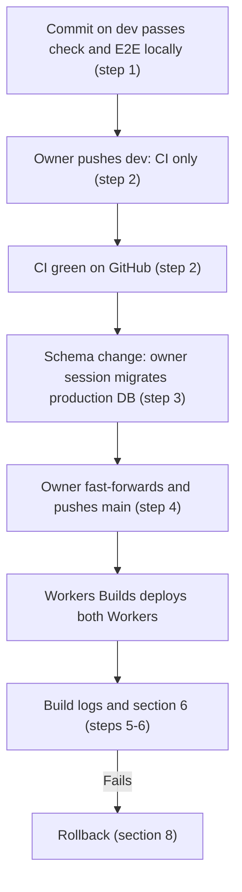

English | [日本語](../ja/DEPLOYMENT.md) · [Docs index](README.md)

# Deployment Runbook

This runbook describes how to set up, migrate, build, deploy, check, and roll back the production Workers on Cloudflare. Code reaches Cloudflare only through Workers Builds, Cloudflare's Git integration: the owner's push to `main` deploys production. A push to `dev` runs CI only. It is for the owner and anyone preparing a deployment for the owner. Enabling AI is in [AI_ENABLEMENT.md](AI_ENABLEMENT.md), and running the deployed app is in [OPERATIONS.md](OPERATIONS.md).

> [!WARNING]
> A push to `main` deploys production. Every other remote step (D1 migrations, Time Travel, rollbacks by command, secrets, Access, dashboard settings) is an owner step. Claude prepares the commands and checks but never runs them, even with approval.

Commands were checked against current official documentation in Phase 6 (2026-10-18; "Phase 6 verification log" in [DECISIONS.md](../working/DECISIONS.md)). Workers Builds was checked on 2026-10-31 (ADR-033). Items marked *(要確認)* are not covered by the documentation and are confirmed at the step where they occur. What has been deployed so far is in section 11.

## 1. Target setup

| | Public Worker | Admin Worker |
|---|---|---|
| Config | `wrangler.jsonc` | `wrangler.admin.jsonc` |
| Serves | Public SPA, read-only API, AI explanation endpoint | Admin SPA and admin API |
| Protection | None (public site) | Worker-level Cloudflare Access ("All traffic") plus JWT validation in every admin API handler (ADR-004) |
| D1 | Same database as the admin Worker, read-only by code (ADR-018) | Owns migrations |
| Optional bindings | `AI`, `AI_CLIENT_RATE_LIMITER` (ADR-026), Durable Object `AI_CLIENT_LIMITER` (ADR-029; required for AI) | `ADMIN_RATE_LIMITER` (ADR-020) |

There is one deployment environment, `production`, with its own D1 database. A named environment deploys as a separate Worker called `<name>-<environment>` unless the environment sets its own `name`:

| Environment | Git branch that deploys it | Public Worker | Admin Worker | D1 database |
|---|---|---|---|---|
| `production` | `main` | `travel-discovery` (`env.production` sets `name`; owner decision 2026-10-18) | `travel-discovery-admin` (likewise) | `travel-discovery-production` |

- Both Workers are connected to this repository in Workers Builds with the branch, build command, and deploy command of section 5.
- A `preview` environment (`travel-discovery-preview`, `travel-discovery-admin-preview`, and the database `travel-discovery-preview`) existed from 2026-10-18 to 2026-10-31. It was removed because local checks and the production checks cover what it was used for (ADR-033 "Amendment 2026-10-31"). Its Cloudflare resources are removed by the owner (3.7).
- Verification before production is local: `npm run check`, `npm run test:e2e`, and for risky migrations a rehearsal on a local copy of production (section 4).
- The Worker name determines the `workers.dev` URL (`<worker>.<account subdomain>.workers.dev`).
- The top-level configuration stays local-only. It is what `npm run dev`, the tests, and E2E use.
- `env.e2e` in `wrangler.admin.jsonc` is for local tests and must never be deployed.

## 2. Who does what

- **Claude** prepares commits, commands, expected output, and checks. It never deploys, never runs a command that needs a Cloudflare login, never logs in or out, and never opens the dashboard.
- **The owner** pushes `dev` and `main` (each push to `main` deploys), takes every dashboard step, and runs every owner session (3.1).
- Each of these is a separate owner decision, in this order for a new environment:
  1. Confirming the account plan in the dashboard (Workers Free; whether a payment method is attached).
  2. Creating each D1 database (3.2).
  3. The configuration change C5 (3.3), committed before the first deployment.
  4. Applying migrations to each remote database (section 4).
  5. Enabling Cloudflare Zero Trust and creating the Access policy for each admin Worker (3.4).
  6. Connecting each Worker to Workers Builds (3.6).
  7. Each push to `main`.
  8. Enabling AI later is a separate decision ([AI_ENABLEMENT.md](AI_ENABLEMENT.md)).

## 3. One-time setup

### 3.1 Owner sessions with Wrangler
Remote commands that Workers Builds cannot run (D1 creation and migrations, Time Travel, `wrangler rollback`, secrets, the first deployment of a new Worker) run in an owner session. The owner runs it in their own terminal and logs out at the end, so no Cloudflare login stays on the machine.

1. Log in. Login uses OAuth in the browser; the credential is stored in the user's home directory, never in the repository.

   ```bash
   npx wrangler login
   ```

   ```bash
   npx wrangler whoami
   ```

2. Run the prepared commands of the step, one at a time.
3. Verify the result as the step describes.
4. Log out, and confirm that no account is shown any more *(要確認: the exact `whoami` wording when logged out)*.

   ```bash
   npx wrangler logout
   ```

   ```bash
   npx wrangler whoami
   ```

Never put an API token in `.dev.vars`, `.env`, or any file in the repository, and never add one to GitHub Actions. The only deploy credential is the Workers Builds token, which stays in Cloudflare (3.6). The evaluation token from Phase 4 should already be deleted (section 10).

### 3.2 D1 databases
Create one database per environment, in an owner session (3.1):

```bash
npx wrangler d1 create travel-discovery-production
```

- Record the printed `database_id` in the matching environment of **both** configs (C5). The ID is not a secret.
- Do not reuse the local placeholder `local-travel-discovery`. A deployment with it fails rather than touching another database (ADR-018).
- `--location` (location hint) is optional. Leave it unset unless the owner chooses one.

### 3.3 Configuration (C5, ADR-026 "Stage 5 preparation decisions" C)
`env.production` exists in both Wrangler configs (Phase 6, 2026-10-18), with its own database and the `namespace_id` values `2001` (public) and `2002` (admin). It also sets `name` to keep the top-level Worker names. `env.preview` (`1001`/`1002`) was removed on 2026-10-31, and its Workers were deleted the same day (3.7), so those IDs are free.

`vars` and bindings are not inherited by named environments, so the environment declares everything it uses:
- **Both Workers:**
  - `d1_databases` with that environment's `database_name` and `database_id` (the admin config also keeps `migrations_dir`).
  - `"observability": { "enabled": true, "logs": { "enabled": true, "invocation_logs": false } }`. This is Workers Logs with the app's own lines only: invocation logs would store each request's IP address, headers, and geolocation ("Phase 7 verification log" in [DECISIONS.md](../working/DECISIONS.md)).
  - `"workers_dev": true` and `"preview_urls": false`, set explicitly so the dashboard cannot silently diverge.
  - `upload_source_maps`.
- **Public Worker:**
  - `ai` binding.
  - `vars` `AI_ASSIST_ENABLED: "false"` and `AI_MODEL: "@cf/google/gemma-4-26b-a4b-it"`.
  - `ratelimits` binding `AI_CLIENT_RATE_LIMITER` (`simple: { limit: 5, period: 60 }`).
  - Durable Object binding `AI_CLIENT_LIMITER` (class `AiClientLimiter`) with the migration `v1` (`new_sqlite_classes`), also at the top level for local runs (ADR-029).
- **Admin Worker:**
  - `ratelimits` binding `ADMIN_RATE_LIMITER` (suggested `limit: 120, period: 60`).
  - `vars` `ACCESS_TEAM_DOMAIN` and `ACCESS_POLICY_AUD`. These are not secrets; they are known after 3.4 and differ for each admin Worker.
- **Rate-limit namespaces:** every `ratelimits` entry needs its own `namespace_id` (a positive integer as a string, unique in the account). Bindings sharing an ID share counters, so two environments must never share one.

> [!WARNING]
> Keep AI settings out of local runs. An `ai` binding always connects to Cloudflare, also from `npm run dev` and the tests.
> - Never add `ai`, `ratelimits`, or AI variables to the top level.
> - Never run `npm run dev` or `npm run dev:admin` with `CLOUDFLARE_ENV` set to a deployment environment, and do not use `npm run preview` after an environment build: both would use that environment's `ai` binding.
> - Run `npm run build` without `CLOUDFLARE_ENV` to return `dist/` and `dist-admin/` to the local configuration.

Checks after a configuration change (local, no login; last passed on 2026-10-31 after removing `env.preview`):
- The top-level build output (`dist/worker/wrangler.json`, `dist-admin/admin_worker/wrangler.json`) is unchanged apart from the list of defined environments.
- `CLOUDFLARE_ENV=production npm run build` writes the expected flattened configuration: the Worker names `travel-discovery` and `travel-discovery-admin`, the production database, and the expected `vars` and rate limiters.
- `npm run check` and `npm run test:e2e` pass.
- `npm run dev` shows no remote-binding warning.

### 3.4 Cloudflare Access for each admin Worker
An admin Worker must never be reachable without Access, but Worker-level Access can only be applied to a Worker that exists. So the first deployment has no URL:

1. Deploy the admin Worker the first time with `"workers_dev": false` (and `"preview_urls": false`) in that environment, so it has no URL. The Access tab is available for such a Worker (checked 2026-10-18).
   - Workers Builds can only connect to a Worker that exists, so this first deployment is an owner session (3.1) with a local build: `CLOUDFLARE_ENV=<env> npm run build`, then `npx wrangler deploy --config dist-admin/admin_worker/wrangler.json`.
   - Connect the Worker to Workers Builds (3.6) only after step 5 below has passed.
2. Enable Zero Trust if needed (dashboard), choosing the team name. Confirm the Free plan's seat limit and login methods (for example One-time PIN) there *(要確認: not stated in the documentation)*.
3. Protect the Worker and restrict the policy to the owner:
   1. Workers & Pages → the admin Worker → Access → "Protect this Worker behind Access" → scope **All traffic**.
   2. The quick setup offers only "Cloudflare account" and "Email domain" policies (checked 2026-10-18). Choose **Cloudflare account** (members of this account only) and apply.
   3. Open Zero Trust → Access controls → Policies, edit the generated reusable policy (`<worker> - Production`), and change its Include rule to the **Emails** selector with the owner's full address.
   4. Never choose "Email domain" for a public mail provider (it admits every address there), the "Everyone" selector, or a "Login Methods: One-time PIN" Include rule, which admits anyone who can receive a PIN.
4. Copy the AUD tag and the team domain into `ACCESS_POLICY_AUD` and `ACCESS_TEAM_DOMAIN` of that environment, set `"workers_dev": true`, commit, and deploy: in the same owner session before the Worker is connected, or by pushing the environment's branch after 3.6. Without the two values every admin API request is answered with 403 (fail closed).
   - AUD tag: Zero Trust → Access controls → Applications → the Worker's application. The documentation names Configure → Additional settings → "Application Audience (AUD) Tag", but the dashboard may differ.
   - Team domain: `https://<team>.cloudflareaccess.com`, from Zero Trust → Settings or derived from the team name chosen when enabling Zero Trust.
5. After any change on the Access tab or the policy, check both the scope (**All traffic**) and the Worker's `workers.dev` URL (Settings → Domains & Routes). On 2026-10-18 the scope was once found on "Previews only", and the URL was once found disabled after Access settings were saved.
   - Right after the deployment that enables `workers_dev`, send an unauthenticated request to `/` and `/api/admin/me`. Both must redirect to `https://<team>.cloudflareaccess.com/...`.
   - If `/` returns 200, remove the URL at once as in [OPERATIONS.md](OPERATIONS.md) 4.2.
6. Do not create hostname or path Access applications with a Bypass policy that match admin hostnames (ADR-004 invariant 4). Do not use account-wide Worker protection either: it would also protect the public site.

Every admin Worker has its own Access setting and AUD. Today there is one, `travel-discovery-admin`.

### 3.5 Secrets
The Workers currently need no secrets: the AI binding needs none, and the Access values are not secret. If a secret is added later, the owner sets it in the dashboard (Settings → Variables & Secrets) or with `npx wrangler secret put <NAME>` in an owner session (3.1); never in files, `.dev.vars`, `.env`, or GitHub. Deployments never delete secrets.

Workers Builds also has build variables and secrets, available only during the build. This project uses none: `CLOUDFLARE_ENV` is part of the build command, so it shows in the settings and in each build log (3.6).

### 3.6 Connecting the Workers to Workers Builds
Each Worker is connected to this repository once, in the dashboard, by the owner, one Worker at a time. Status: both production Workers were connected on 2026-10-31. The first builds deployed commit `59b754c` as new versions, and section 6 passed (ADR-033 "Amendment 2026-10-31"). The steps below are for reconnecting a Worker or connecting a new one.

**Before:**
- Billing (owner): the Workers plan is Free and Billing lists only the domain registration ([OPERATIONS.md](OPERATIONS.md) section 3).
- `main` points at a commit that is ready to deploy, and CI is green on it. On 2026-10-31 `main` still pointed at the initial commit, which has no `package.json`, when the Workers were connected. A build of it could not deploy anything; the push of `59b754c` started the first real build.
- The Worker already exists (3.4 for a new admin Worker).

**For each Worker** (Workers & Pages → the Worker → Settings → Build → Connect):
1. Git provider: GitHub, this repository.
   - If Cloudflare asks to install or extend its GitHub app, give it access to **only selected repositories** and add this repository. The app that my-music-site uses may already be installed *(要確認: whether Workers Builds uses the same app and repository list)*.
2. Settings, from the table in section 5:
   - Git branch: `main`.
   - Build command and deploy command exactly as in section 5. The `CLOUDFLARE_ENV=production` prefix works: the first builds deployed the production bindings (2026-10-31). Without it, the build would use the top-level configuration and the deployment would fail on the placeholder database `local-travel-discovery` (ADR-018).
   - Root directory: empty (the repository root, where both Wrangler configs are).
   - Build variables and secrets: none.
   - Build watch paths: leave the default (every change) unless the owner decides otherwise (section 5 "Build minutes").
3. Branch control: **disable preview builds** (builds for non-production branches).
   - Otherwise a push to any other branch would create a public Preview with its own URL, outside the reviewed `workers_dev` and Access setup.
   - Do not switch the Worker to the new Worker Previews model: the documentation says the switch cannot be reversed (ADR-033).
4. API token: select the token already used by the other Worker. Let Cloudflare create one only if none exists.
   - The documented permissions are Account Settings read, Workers Scripts edit, Workers KV Storage edit, Workers R2 Storage edit, Workers Routes edit on all zones, User Details read, and Memberships read. None of them is a billing, plan, payment, or member permission.
   - The generated token actually has a wider list, including D1, Workers AI, and Secrets Store edit, but still no billing, plan, payment, member, or API-token permission (observed 2026-11-01, ADR-033).
   - Owner: check the token in My Profile → API Tokens. Do not save any change on that page. A token with any billing or account-admin permission is an incident: revoke it and record it in [DECISIONS.md](../working/DECISIONS.md).
   - The token stays in Cloudflare. Never copy it into a file, GitHub, or a chat.
5. Save. Saving may start a build of the branch head at once *(要確認)*. So before connecting, make sure the head of `main` is a commit that is ready to deploy, and check the build as in step 6.
6. Check the first build of the Worker:
   - The build log shows the Node.js version from `.nvmrc` (24) *(要確認: the build image's Node.js selection)* and the Wrangler version from `package.json`.
   - The deploy step names the expected Worker and lists the expected bindings: the production D1 database, `AI_ASSIST_ENABLED` `"false"` on the public Worker, and the rate limiter with the production `namespace_id`.
   - The Worker's Deployments list shows a new version from that commit.
   - Note the build duration (section 5 "Build minutes").
   - Run section 6. After the admin Worker, add `--watch-admin 120`.

**After:**
- Record the date, build durations, and version IDs in [DECISIONS.md](../working/DECISIONS.md) and in section 11.
- The login left on this machine by the earlier local deployments is no longer needed. Log out now and confirm it (3.1, step 4):

  ```bash
  npx wrangler logout
  ```

  ```bash
  npx wrangler whoami
  ```

- From now on every owner session ends with `npx wrangler logout`, so no step in this runbook leaves a Cloudflare login on the machine.

### 3.7 Removing the preview resources (owner, one-time)
The preview environment was removed from the configuration on 2026-10-31, but its Cloudflare resources stay until the owner deletes them. They cost nothing on Workers Free, but the public preview Worker keeps serving old code and seed data at a public URL. Status: done by the owner on 2026-10-31. During it the production Access application was lost as well, which exposed the production admin SPA without Access until the owner disabled `workers.dev` (incident in ADR-033 "Amendment 2026-10-31"). The steps below include the checks that would have caught it.

Each deletion is permanent and is the owner's decision. Delete in this order, so the admin preview Worker is never reachable without Access:

1. **The admin preview Worker first.** Workers & Pages → `travel-discovery-admin-preview` → Settings → Delete *(要確認: exact labels)*. It is not connected to Workers Builds.
2. **The public preview Worker.** Workers & Pages → `travel-discovery-preview` → Settings → Delete. This also deletes its Durable Object `AiClientLimiter` data, which holds only per-address AI counters.
3. **The Access application of the admin preview Worker**, only after step 1. Zero Trust → Access controls → Applications → the application of `travel-discovery-admin-preview` → Delete.
   - Before deleting, open the application and check that its domain is `travel-discovery-admin-preview.<account subdomain>.workers.dev` and that its AUD tag is not the `ACCESS_POLICY_AUD` of `env.production` in `wrangler.admin.jsonc`. The names of the two applications differ only by `-preview`.
   - The application may already be gone after step 1. Then skip this step; never delete another application instead.
   - Then, in Access controls → Policies, delete the reusable policy `travel-discovery-admin-preview - Production` only if no application uses it any more. The production application has its own policy.
   - Right afterwards, run `node scripts/check-deployment.mjs <account subdomain> production --watch-admin 120`. Any 200 from the admin Worker is an incident ([OPERATIONS.md](OPERATIONS.md) 4.2).
4. **The preview D1 database.** Storage & Databases → D1 → `travel-discovery-preview` → Settings → Delete *(要確認: exact labels)*. It holds only `db/seed/dev.sql` data and the content imported for checks, so no export is needed. Deleting a database cannot be undone with Time Travel.
5. **Check:**
   - `node scripts/check-deployment.mjs <account subdomain> production --watch-admin 120` passes.
   - `https://travel-discovery-preview.<account subdomain>.workers.dev/` and `https://travel-discovery-admin-preview.<account subdomain>.workers.dev/` no longer return 200.
   - Workers & Pages lists only `travel-discovery` and `travel-discovery-admin` for this app, and D1 lists only `travel-discovery-production`.
6. Record the date in [DECISIONS.md](../working/DECISIONS.md) (ADR-033) and in section 11. The `namespace_id` values `1001` and `1002` may be reused afterwards.

All of these are dashboard steps; no login on this machine is needed.

## 4. Database migrations
Migrations are applied only through the admin config, in an owner session (3.1). Workers Builds never applies them.

> [!WARNING]
> A push to `main` deploys at once. Apply a migration to the production database **before** pushing the commit whose code needs the new schema to `main`.

The order for a commit that needs a schema change:

1. The migration is backward compatible with the code deployed now (section 8). `npm run check` and `npm run test:e2e` pass locally on the commit; they apply every migration to a fresh local database.
2. For a migration that rebuilds tables or changes data, rehearse it on a local copy of production first (below).
3. Owner session: record a Time Travel bookmark, apply the migration to `travel-discovery-production`, verify, log out.
4. Owner: push `main`. Workers Builds deploys both Workers. Run section 6.

The production command:

```bash
npx wrangler d1 migrations apply travel-discovery-production --remote --env production --config wrangler.admin.jsonc
```

- Wrangler lists the pending migrations, asks for confirmation, and captures a backup before applying.
- Before applying, record a restore point: `npx wrangler d1 time-travel info travel-discovery-production`.
- Make schema changes backward compatible with the previously deployed code: a code rollback does not roll back the database (section 8).
- `db/seed/dev.sql` is local test data. Never load it into production; production content is entered through the admin console.

**Rehearsal on a local copy of production (optional).** This replaces the former preview database for risky migrations.
1. Owner session: export the production database to a file **outside the repository**, because it contains the published content. Log out.

   ```bash
   npx wrangler d1 export travel-discovery-production --remote --output ~/travel-discovery-backups/production.sql
   ```

2. Locally, with no login, load it into a separate local state and apply the pending migrations:

   ```bash
   npx wrangler d1 execute travel-discovery --local --persist-to .wrangler/rehearsal --config wrangler.admin.jsonc --file ~/travel-discovery-backups/production.sql
   ```

   ```bash
   npx wrangler d1 migrations apply travel-discovery --local --persist-to .wrangler/rehearsal --config wrangler.admin.jsonc
   ```

3. Compare row counts before and after, and check the migrated tables. Delete `.wrangler/rehearsal` and the export afterwards *(要確認: whether the exported SQL imports into a local database without changes)*.

## 5. Build and deploy
Workers Builds builds and deploys every push to `main`. A push to `dev` runs GitHub Actions CI only. Each Worker has these settings (3.6):

| Worker | Git branch | Build command | Deploy command |
|---|---|---|---|
| `travel-discovery` | `main` | `CLOUDFLARE_ENV=production npm run build` | `npx wrangler deploy --config dist/worker/wrangler.json` |
| `travel-discovery-admin` | `main` | `CLOUDFLARE_ENV=production npm run build` | `npx wrangler deploy --config dist-admin/admin_worker/wrangler.json` |

Both: root directory empty, no build variables, preview builds disabled. `npm run build` builds both Workers every time, so the type check and the bundle checks (ADR-004) run in every build.



1. Commit on `dev`, and run `npm run check` and `npm run test:e2e` locally on the commit.
2. Owner: push `dev`. Nothing deploys. Wait until GitHub Actions CI is green on that commit; Workers Builds would not wait for it.
3. If the commit needs a schema change, apply the migration to the production database first (section 4).
4. Owner: bring `main` to the tested commit and push it. This deploys `travel-discovery` and `travel-discovery-admin`. Push only a commit whose CI is green, with nothing new on top.

   ```bash
   git switch main
   ```

   ```bash
   git merge --ff-only dev
   ```

   ```bash
   git push origin main
   ```

5. Read the two build logs in the dashboard (the Worker → Deployments or Builds *(要確認: exact tab)*):
   - The build ran the expected command, and `npm run build` passed, including the type check and the bundle checks.
   - The deploy step names the expected Worker and lists the expected bindings and `vars`: the production D1 database, `AI_ASSIST_ENABLED`, and the rate limiter with the production `namespace_id`.
   - This check matters because Workers Builds sets the deployed Worker's name itself ("Worker name" below). A wrong build command could deploy the top-level or another environment's bindings under the right name.
6. After **both** builds have finished, run section 6. Record the version IDs in section 11 when the deployment is worth recording.

**Notes:**
- **Every push to `main` deploys**, also commits that change only docs. A build that fails deploys nothing, and the previous version keeps serving.
- **One build at a time** on Workers Free. The two Workers build one after the other, so for a few minutes the public and admin Workers can run different commits. This is safe because schema changes are backward compatible (section 4) and the two Workers share only the database.
- **No `.dev.vars` in the build.** Workers Builds starts from a clean checkout, so the `.dev.vars` copy described in [DEVELOPMENT.md](DEVELOPMENT.md) does not happen there. It still happens in local builds.
- **Dashboard edits** of variables or `workers.dev` are overwritten by the next build's deployment, as before.
- **Worker name.** Workers Builds requires the dashboard name of the Worker to match the `name` in the Wrangler configuration of the root directory, except for Wrangler environments with the same base name. On Wrangler v3 and later it sets the name of the connected Worker itself, through `WRANGLER_CI_OVERRIDE_NAME` (Troubleshooting page, updated 2026-10-30). The root `wrangler.jsonc` is named `travel-discovery`, so the admin Worker relies on that override. The override works: the builds of `b369997` succeeded on both Workers (2026-11-01).
- **Build minutes.** Workers Free includes 3,000 build minutes per month, one concurrent build, and a 20-minute timeout. A push to `main` runs two builds; pushes to `dev` run none. At T minutes per build that is 3,000 / (2 × T) pushes to `main` per month. The builds took 1 min 3 s (`travel-discovery`) and 49 s (`travel-discovery-admin`) on 2026-11-01, so about 1,500 pushes fit, or 1,000 if each build is rounded up to whole minutes (rounding not documented). What happens when the minutes run out is not documented *(要確認)*. The plan is to stop pushing and wait for the monthly reset, never to upgrade. If usage passes half of the allowance, build watch paths that skip docs-only commits are the first measure (owner decision).

**Local dry run (optional, no login).** To see the flattened configuration before pushing, build locally and run a dry run. Return to the local configuration afterwards with `npm run build` (3.3).

```bash
CLOUDFLARE_ENV=production npm run build
```

```bash
npx wrangler deploy --dry-run --config dist/worker/wrangler.json
```

```bash
npx wrangler deploy --dry-run --config dist-admin/admin_worker/wrangler.json
```

- The dry run prints the bindings and `vars`, but not the Worker name, which is the `name` field of the same `wrangler.json`.
- Always use the explicit `--config` paths. Each build also writes a redirect file: `.wrangler/deploy/config.json` for the public build, and `admin/.wrangler/deploy/config.json` for the admin build (the admin Vite root is `admin/`). Checked 2026-10-18 with Wrangler 4.151.1:
  - A plain `npx wrangler deploy` from the repository root follows the redirect and deploys **only the public Worker**.
  - With `--config <generated wrangler.json>`, the redirect is not used.
  - `--cwd admin` fails, because the redirect file does not sit next to a user configuration.
- `CLOUDFLARE_ENV` is read by the Vite plugin at build time; `wrangler deploy` ignores it.

**Local deployment (exception).** Deploying from this machine is only for a new Worker that cannot be connected yet (3.4), or when Workers Builds cannot deploy (for example an outage or no build minutes left) and the owner decides so, recorded in [DECISIONS.md](../working/DECISIONS.md). It is an owner session (3.1): build as above, deploy with the same commands without `--dry-run`, verify (section 6), and log out.

## 6. Checks after each deployment
The unauthenticated checks below are automated:

```bash
node scripts/check-deployment.mjs <account subdomain> production
```

Add `--watch-admin 120` after an admin deployment. Ongoing monitoring, routine checks, and incident response are in [OPERATIONS.md](OPERATIONS.md).

These can only be checked on a deployed Worker (from "Admin authentication status" and the verification logs in [DECISIONS.md](../working/DECISIONS.md)):
- Every admin URL (`workers.dev`, routes, custom domains) redirects to the Access login when not signed in. The admin static assets are not reachable without login.
- After login, the admin API accepts the request: the `Cf-Access-Jwt-Assertion` header reaches the Worker through the static-assets router and the token validates (RS256, issuer, audience).
- Version URLs are disabled for both Workers. The dashboard (the Worker → Deployments) lists the deployed versions without a login on this machine.
- No Preview was created: preview builds are disabled for the Worker (3.6), and the Worker has no Previews listed *(要確認: where the dashboard lists Previews)*.
- The public and admin Workers see the same D1 data (publish in admin, then check the public API).
- The public site works end to end in `ja`, `en`, `es`, and `fr`. The AI toggle shows the "unavailable" notice while AI is disabled.
- The Rate Limiting bindings deploy without errors (availability on the account is unconfirmed, ADR-026). If the deployment rejects them, remove them from that environment, record the result, and keep AI disabled (ADR-026 A, precondition 2).
- Workers Logs shows the AI endpoint's `disabled` outcome lines without addresses or answers.

## 7. Enabling AI (separate approval)
Enabling AI has its own runbook: [AI_ENABLEMENT.md](AI_ENABLEMENT.md). The former subsections moved there:

- Preconditions and general steps: [AI_ENABLEMENT.md](AI_ENABLEMENT.md) section 1.
- 7.1 Preview trial: [AI_ENABLEMENT.md](AI_ENABLEMENT.md) section 2.
- 7.2 Limiter check with AI disabled: [AI_ENABLEMENT.md](AI_ENABLEMENT.md) section 3.
- 7.3 Enabling AI on production: [AI_ENABLEMENT.md](AI_ENABLEMENT.md) section 4.

## 8. Rollback
- **Code, fast (owner, dashboard):** Workers & Pages → the Worker → Deployments → Rollback. `npx wrangler rollback <VERSION_ID> --name <worker>` in an owner session (3.1) does the same.
  - It takes effect immediately and works for the 100 most recent versions.
  - It does not change bound resources: the database stays at its current schema and data.
  - Static assets roll back with the version. Checked on the public preview Worker on 2026-10-25 ("Phase 10 verification log" in [DECISIONS.md](../working/DECISIONS.md)): the served `index.html` and client bundle switched to those of the target version within about 20 s in both directions, and the other version's bundle was no longer served.
  - The next push to that Worker's branch deploys the branch head again. So follow a rollback with a fix or a revert on the branch before the next push.
- **Code, through Git:** revert the bad commit (`git revert <commit>`), check it locally, and push the branch. Workers Builds deploys both Workers of the environment. This takes a build per Worker, so it is slower than the dashboard.
- **Data:** `npx wrangler d1 time-travel restore <database> --timestamp <unix|RFC3339>` (or `--bookmark`) restores a point within 7 days on Workers Free, in an owner session (3.1). It is **destructive**: it replaces all data, cancels in-flight queries, and prints a bookmark to undo it. Every restore is an owner decision.
- **AI problems:** use the kill switch ([AI_ENABLEMENT.md](AI_ENABLEMENT.md)) instead of a rollback.

## 9. Free-tier assumptions (re-check before deploying)
Checked 2026-10-18 ("Phase 6 verification log" in [DECISIONS.md](../working/DECISIONS.md)); free tiers and limits change.
- **Workers Free:** 100,000 requests/day per account (Error 1027 when exceeded, reset 00:00 UTC), 10 ms CPU per request. Static asset requests do not invoke the Worker ([DECISIONS.md](../working/DECISIONS.md) Phase 0 log). https://developers.cloudflare.com/workers/platform/limits/
- **D1 Free:** 5 million rows read and 100,000 rows written per day for the whole account (queries fail with a `D1_ERROR` until 00:00 UTC), 500 MB per database, 7-day Time Travel. https://developers.cloudflare.com/d1/platform/pricing/
- **Workers AI:** 10,000 Neurons/day free; on Workers Free, usage fails after that without charge. https://developers.cloudflare.com/workers-ai/platform/pricing/
- **Workers Logs:** 200,000 events/day, 3-day retention on Free.
  - **From 2026-12-01 Workers Logs moves to Cloudflare Observability pricing**: on Free 0.5 GB ingestion per day and 7-day retention; ingestion stops at the limit without charge.
  - Checked 2026-10-19 and re-checked 2026-10-24 and 2026-10-25, unchanged ("Phase 7 verification log", "Phase 8 verification log", and "Phase 9 verification log" in [DECISIONS.md](../working/DECISIONS.md)).
  - The account's daily volume, read on 2026-10-24, is a few percent of the allowance at most. The first check after the change is a dated task ([OPERATIONS.md](OPERATIONS.md) sections 3 and 7).
  - https://developers.cloudflare.com/workers/observability/logs/workers-logs/, https://developers.cloudflare.com/observability/pricing/
- **Workers Builds:** on Free 3,000 build minutes per month, 1 concurrent build, 20-minute timeout; on Paid 6,000 minutes, then USD 0.005 per minute. What happens on Free when the minutes run out (stop or charge) is not stated *(要確認; treated as possibly billing until confirmed, so the minutes are watched monthly)*. Checked 2026-10-31. https://developers.cloudflare.com/workers/ci-cd/builds/limits-and-pricing/ (updated 2026-10-28)
- **Rate Limiting binding:** availability and price on Workers Free are not documented; the bindings have deployed without errors since 2026-10-18. https://developers.cloudflare.com/workers/runtime-apis/bindings/rate-limit/
- **Cloudflare Zero Trust Free:** seat limit, price, and login methods are not stated on the plans page; confirm in the dashboard. https://www.cloudflare.com/plans/zero-trust-services/

## 10. Manual checks before the first deployment (owner)
- [ ] `npm run check` and `npm run test:e2e` pass on the commit to deploy; CI is green on GitHub after the push.
- [ ] `git status` is clean; no `.dev.vars`, `.env`, `.ai-eval/`, or `dist*/` content is committed.
- [ ] Keyboard-only run through the public quiz and the admin destination form in Chrome, with visible focus.
- [ ] Screen-reader spot check (VoiceOver) of the quiz, results, and language switcher.
- [ ] Light and dark mode, and 200% zoom, on a phone-sized and a desktop window.
- [ ] Reduced-motion setting: no blocking animation.
- [ ] Content review: costs show basis, source, and date; no wording suggests live prices; all published content has `ja` and `en` translations at least.
- [ ] Outbound search links open the provider start pages only, in a new tab.
- [x] The evaluation API token from Stage 5 has been deleted in the dashboard (owner, 2026-10-24).
- [x] The Gemma terms of use and prohibited-use policy have been reviewed (before enabling AI; owner, 2026-10-24).
- [ ] Commit author emails are acceptable for the intended visibility of the repository ([PUBLIC_RELEASE.md](../working/PUBLIC_RELEASE.md)).

## 11. Deployment history

Status as of Phase 6 (2026-10-18) and later deployments. Details are in the verification logs of [DECISIONS.md](../working/DECISIONS.md). Until the move to Workers Builds on 2026-10-31 (3.6), every deployment was made from the owner's local Wrangler login.

**Preview (2026-10-18):**
- The preview D1 database `travel-discovery-preview` was created (region APAC). `env.preview` (C5) is configured in both Wrangler configs with its ID.
- Migrations `0000`–`0001` were applied and `db/seed/dev.sql` was loaded into it (owner-approved, preview only).
- The admin Worker `travel-discovery-admin-preview` was deployed once with `workers_dev: false` (version `be458778`; Wrangler reported "No targets deployed", so it has no URL) for the Access setup in 3.4.
- The owner then enabled Zero Trust and Worker-level Access ("All traffic") on it, with the generated reusable policy changed to an **Emails** Include rule for the owner's address. `env.preview` of the admin config has the Access values.
- Incident: a deployment with `workers_dev: true` exposed the admin SPA without Access for about two minutes (the API stayed 403). It was reverted to `workers_dev: false`; the Access scope had become "Previews only" and was set back to "All traffic" ("Phase 6 verification log" in [DECISIONS.md](../working/DECISIONS.md)).
- The admin Worker was then redeployed (version `8bc1cc2c`) and verified behind Access: unauthenticated requests are redirected to the Access login, and the owner signed in and used the admin UI ("Admin authentication status" in [DECISIONS.md](../working/DECISIONS.md)).
- The public Worker `travel-discovery-preview` was deployed (version `ea2abe3d`, AI disabled). It passed the checks in section 6 except the Workers Logs check ("Phase 6 verification log" in [DECISIONS.md](../working/DECISIONS.md)).

**Production (2026-10-18):**
- The production D1 database `travel-discovery-production` was created (region APAC). `env.production` is configured in both Wrangler configs with its ID.
- After recording a Time Travel bookmark of the empty database, migrations `0000`–`0001` were applied (18 tables, no content rows, no seed data).
- The production admin Worker `travel-discovery-admin` was deployed once with `workers_dev: false` (version `86694c6e`, "No targets deployed") for the Access setup.
- After the owner set up Access (All traffic, Emails policy, scope re-checked), it was redeployed with `workers_dev: true` (version `1b184825`). Every checked path redirected to the Access login from the first request and for two minutes after. The owner signed in and saw the empty admin lists, and `/api/admin/me` returned the owner's address.
- The public production Worker `travel-discovery` was deployed (version `87d11262`, AI disabled) with an empty database. The same `curl` checks as for preview passed (no content yet: 0 destinations and questions).

**Later (2026-10-24):**
- All four Workers were redeployed with Workers Logs invocation logs disabled (preview `def4b576` / `e45a9449`, production `f73d57c0` / `07a234a3`). They passed the same checks, including the Access redirect on both admin Workers ("Phase 7 verification log" in [DECISIONS.md](../working/DECISIONS.md)).
- The admin Workers were redeployed with the content import (preview `3e2b9f30`, production `9d51e1a4`).
- `content/initial-v1.json` was imported on preview and production. Production then had 18 published destinations and 12 questions (ADR-028).

**Workers Builds (2026-10-31):**
- The owner connected `travel-discovery` and `travel-discovery-admin` to `main` (3.6). The push of `59b754c` to `main` started the first builds, which deployed new versions; the code was the same as the Phase 17 deployment (`ef6d323`). Version IDs were not recorded. Build durations (2026-11-01): 1 min 3 s for `travel-discovery`, 49 s for `travel-discovery-admin`.
- `scripts/check-deployment.mjs <account subdomain> production --watch-admin 120` passed: the public API in all four locales, AI disabled, and every admin path redirected to the Access login for two minutes.
- The preview environment was removed from the configuration (ADR-033 "Amendment 2026-10-31"). The owner then deleted its two Workers, the Access application, and the database (3.7); both preview URLs answer 404.
- Incident: after the deletion, the production admin Worker answered 200 on `/` and `/destinations` without Access for at least the two minutes of the check; `/api/admin/me` answered 403, so no admin data was reachable. The owner disabled `workers.dev` and found the Access application of `travel-discovery-admin` re-created with a new AUD tag (by the owner in the dashboard, by the owner's recollection). Its scope is All traffic and its policy an Emails rule for the owner. The new AUD is in `env.production` of `wrangler.admin.jsonc`. After the push of that commit (`b369997`), `workers.dev` was enabled again, the checks with `--watch-admin 120` passed, and the owner signed in to the admin console (ADR-033).
