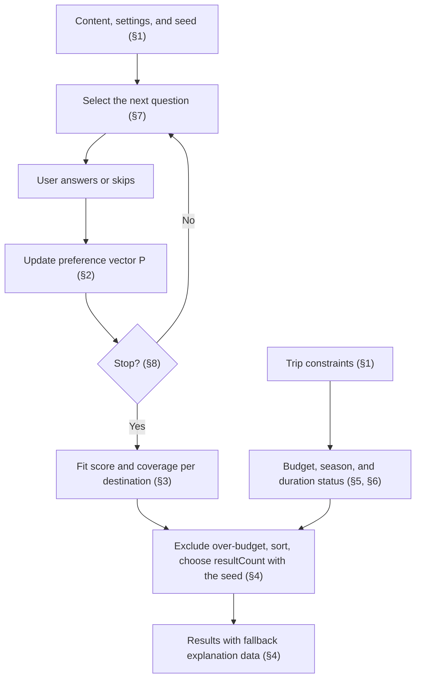

English | [日本語](../ja/DIAGNOSTIC_ALGORITHM.md) · [Docs index](README.md)

# Diagnostic Algorithm — Travel Discovery

This document is the specification for the deterministic quiz and ranking engine (Phase 2). The implementation lives in `domain/diagnosis/` and must match this document; tests in `domain/diagnosis/*.test.ts` encode the examples below. Decisions and rationale are recorded in [DECISIONS.md](../working/DECISIONS.md) ADR-021, ADR-031, and ADR-037.

The engine is pure TypeScript: no React, database, Cloudflare bindings, network, or AI. Given the same content, answers, constraints, settings, and seed, it always returns the same output.

## How the parts fit together

The quiz loop picks questions until the stopping rule ends it; the answers then feed scoring and ranking. Trip constraints only annotate and filter; they never change the fit score.



## 1. Inputs

- **Content**: attributes, questions (with category, type, priority, options, and option effects), and destinations (with attribute scores, recommended days, best months, and cost estimates).
  - Entities are identified by their stable slug; an option by `(question slug, option value)`.
  - Status fields are included so the engine can ignore inactive content itself.
- **Answers**: an ordered list of `{ question, options[] }`. An empty `options` list means the question was shown and skipped.
- **Trip constraints** (all optional): trip length in days, travel months (1–12), and a budget `{ amount, currency }`.
- **Settings**: `minQuestions`, `targetQuestions`, `maxQuestions`, `resultCount` (validated by `server/admin/settings.ts`).
- **Seed**: an unsigned 32-bit integer chosen per quiz session (by the client in Phase 3).

### Usable content
- Attribute: `status = active`.
- Question: `status = published`, its category is `active`, it has at least two `active` options, and at least one active option has a non-zero effect on a usable attribute. Questions failing the last rule carry no scoring signal and are skipped (reported as `questionsWithoutEffects`).
- Option: `status = active`. Effects on inactive attributes are ignored.
- Destination: `status = published`.

## 2. Preference vector

For each usable attribute `a`, the preference `P[a]` is the sum over answered questions of that question's contribution `c_q[a]`.

**Answer normalization.** Invalid answers are ignored and reported with a reason code, never thrown:
- The question must be usable; otherwise `unknown_question`.
- Only the first answer to a question counts; later ones are `duplicate_question`.
- Selected values are deduplicated; values that are not active options of that question are dropped.
- No remaining option: the answer counts as skipped (`no_valid_option` if values were given).
- `single_choice` with more than one remaining option: `too_many_options` (ignored).

**Skipped and unanswered questions.** These never pull scores toward any destination:
- A skipped answer (empty `options`, or no remaining option after normalization) and an ignored `too_many_options` answer contribute nothing to `P`. They are not treated as 0-weighted selections.
- Such a question still counts as already shown for selection and the question count (§7, §8).
- Questions never shown contribute nothing.

**Contribution.** Let `S` be the remaining selected options and `k = |S|`.

```
c_q[a] = ( Σ_{o ∈ S} w_o[a] ) / k
```

- `w_o[a]` is option `o`'s effect weight on `a` (integer −5..5), and **0 when the option defines no effect on `a`**.
- The denominator is always `k`, including options with no effect on `a`. This keeps the influence of one question bounded by the largest single-option effect regardless of how many options are selected.
- A `single_choice` answer is the case `k = 1`.

Example (`multiple_choice`, options A `{nature +3, beach +2}`, B `{nature +1}`, C `{food +3}`):

| Selected | nature | beach | food |
|---|---|---|---|
| A | 3 | 2 | 0 |
| A, B | (3+1)/2 = 2 | (2+0)/2 = 1 | 0 |
| A, C | (3+0)/2 = 1.5 | (2+0)/2 = 1 | (0+3)/2 = 1.5 |

## 3. Destination fit score

Destination attribute scores are integers 0–5. They are centered so that a mid score is neutral and negative preferences penalize high scores:

```
x_d[a] = (2 · score_d[a] − 5) / 5        ∈ [−1, 1]
x_d[a] = 0                               when the destination has no score for a
S_d    = Σ_a P[a] · x_d[a]
fit_d  = 50 + 50 · S_d / Σ_a |P[a]|      ∈ [0, 100]
fit_d  = 50                              when Σ_a |P[a]| = 0 (no preference signal)
```

Example: `P = {nature: 2, beach: 1}`.
- X with `nature 5, beach 1`: `x = (1, −0.6)`, `S = 2 − 0.6 = 1.4`, `fit = 50 + 50 · 1.4 / 3 ≈ 73.33`.
- Y with `nature 2, beach 5`: `x = (−0.2, 1)`, `S = −0.4 + 1 = 0.6`, `fit = 50 + 50 · 0.6 / 3 = 60`.

**Coverage** is the share of signalled attributes (`P[a] ≠ 0`) for which the destination has a score. With no signal, it is the share of usable attributes the destination has a score for. Missing scores lower coverage instead of being treated as 0.

The fit is a relative fit against current content data, not a probability. The UI shows `round(fit)`; ranking uses the unrounded value.

## 4. Ranking and tie-breaking

1. Take usable destinations.
2. Compute budget, season, and duration status (sections 5–6).
3. Exclude destinations whose budget status is `over` (the only hard filter).
4. Sort by `fit` descending, then `coverage` descending, then slug ascending (code-unit order, locale-independent).
5. Choose `resultCount` (3–5) of them with the session seed ("Result variety" below) and return them in the order of step 4, ranked 1, 2, … by position.
   - If fewer remain, return them with notice `fewer_than_requested`; with none, notice `no_eligible_destinations`.
   - Notice `no_preference_signal` is added when `Σ|P| = 0`.

Budget, season, and duration never change `fit`.

### Result variety
The best fit is always shown first; the other slots come from destinations that fit almost as well, chosen with the quiz's session seed (ADR-037). So the same answers can show different destinations in different quizzes, while the order and every fit value stay deterministic.

1. **Band.** The destinations after the first, among the best **12** in the order of step 4, whose `fit` is at least the best fit minus **10** points.
2. If the band has no more destinations than the free slots (`resultCount − 1`), the result is the first `resultCount` in order, as without variety, and no other draw is offered.
3. Otherwise each band destination gets a key `ln(u) / w`, where `u` in (0, 1) is derived from the seed, the draw number, and its slug, and `w = 1 + (fit − floor) / 10` with `floor` the band's lower bound. So a destination at the best fit is twice as likely to be drawn as one at the floor. The free slots take the largest keys (a weighted draw without replacement).
4. **Draws.** "Show other destinations" increases the draw number `k` (at most 20). Draw `k` puts destinations not shown in draws `0…k−1` before those already shown, so all band destinations are shown before any repeats. The draw number returns to 0 whenever the answers change or a new quiz starts.
5. The chosen destinations are returned in the order of step 4, so the fit shown on the cards never increases down the page.

`u = (mix32(mix32(seed ⊕ 0x3c6ef372 ⊕ (k + 1)·0x9e3779b9) ⊕ fnv1a(slug)) + 0.5) / 2³²`, with 32-bit FNV-1a and the MurmurHash3 finalizer `mix32` (`domain/diagnosis/variety.ts`). The salt keeps the draw independent of question selection, which uses the same seed (§7). A destination's `u` depends only on the seed, the draw, and its slug, so adding or removing a destination does not change the others' keys.

The values come from simulated quizzes on `content/initial-v10.json` (ADR-037): the best fit stays first in every quiz; one answer set gets about 14–20 different result sets over 30 seeds; the mean fit of the shown results is about 1 point lower than with the first five. Variety alone barely changes how often each destination appears (Cape Town in 38% of results instead of 43%), because the most frequent destinations are usually close to the top.

### Fallback explanation data
Each result carries structured data from which the UI builds the deterministic, localized explanation (no AI):
- the top three attributes by positive contribution `P[a] · x_d[a]` among attributes the user wants (`P[a] > 0`; ties by slug);
- up to two **distinctive strengths** (below);
- the budget, season, and duration statuses;
- coverage.

The UI combines these with the destination's authored summary/highlights and message-catalog templates.

"Why it fits" names only what the user asked for. A disliked attribute that the destination lacks (`P[a] < 0`, low score) still raises `fit`, but it is never listed as a match. Example: with `beach` at −3, a destination with `beach 0` gains `+3` in `S_d` but does not show "Beaches". This list is not sent to the optional AI explanation (since Phase 22, ADR-026).

**Distinctive strengths** tell the shown results apart, because their top attributes are often the same few the user asked for. For each shown result, an attribute is a strength when:
- the user wants it (`P[a] > 0`) and the destination has a score for it;
- its score is at least **0.75** points above the mean score of the shown results, that is `x_d[a] − mean(x[a]) ≥ 0.3`, where a missing score counts as `x = 0` in the mean, as in the fit.

At most two are listed, by `P[a] · (x_d[a] − mean(x[a]))` descending, ties by slug. A single result has none. Strengths are explanation data only: they never change `fit`, coverage, or the order, and they are not sent to the AI.

Example: the shown results score `nature` 5, 4, 4, 4, 4 (mean 4.2). The first is 0.8 above the mean, so `nature` is its strength; the others are below the mean. The margin 0.75 was chosen from simulated quizzes on `content/initial-v8.json` (ADR-035).

## 5. Budget comparison

Budget comparison is a separate module (`budget.ts`) and is not part of scoring.

- The user budget is an **upper limit**, per person, for the whole trip, **excluding international flights**, in `JPY`, `USD`, or `EUR` (default `JPY`).
- A destination may have at most one cost estimate per currency. The comparison uses the estimate whose currency equals the budget currency **and** whose scope is `per_person_excluding_international_flights`. No currency conversion is performed.
- Estimate range for the trip:
  - `per_trip`: `[min, max]`.
  - `per_day` with trip days `n`: `[min · n, max · n]`.
  - `per_day` without trip days: `[min · recommendedDaysMin, max · recommendedDaysMax]`; if either recommended bound is missing, the status is `unknown`.

| Status | Condition | Effect |
|---|---|---|
| `not_applicable` | no budget supplied | kept |
| `unknown` | no cost estimate, or a `per_day` range that cannot be scaled | kept, flagged |
| `incomparable` | estimates exist but none matches the budget currency and scope | kept, flagged |
| `within` | range upper bound ≤ budget | kept |
| `partial` | lower bound ≤ budget < upper bound | kept |
| `over` | lower bound > budget | **excluded** |

A destination is excluded only when even its lowest plausible cost exceeds the budget. Exclusion uses the cheapest end of the estimate and, when trip days are missing, the shortest recommended stay. A lower bound equal to the budget is not `over`.

Adding currencies or a conversion strategy later means adding estimates or replacing the estimate-selection step; scoring and ranking are unaffected.

## 6. Season and duration (annotations only)

Neither status excludes destinations or changes their order.

- **Season**: destinations store best months (1–12) or nothing. With travel months `M`:
  - all of `M` in best months → `in_season`;
  - some → `partly_in_season`;
  - none → `off_season`;
  - destination without data → `unknown`;
  - no travel months → `not_applicable`.
- **Duration**: with trip days `n`:
  - `n < recommendedDaysMin` → `shorter_than_recommended`;
  - `n > recommendedDaysMax` → `longer_than_recommended`;
  - both bounds missing → `unknown`;
  - otherwise `within_recommended`;
  - no trip days → `not_applicable`.

## 7. Question selection

Selection is a pure function of content, answers so far, settings, and seed.

**Candidates**: usable questions not yet answered (including skipped).

**Weight** of candidate `q`:

```
weight_q = priorityWeight_q · 1 / (1 + askedInCategory_q) · novelty_q
novelty_q = 2 if q has an effect on any attribute with P[a] = 0, else 1
```

- `askedInCategory_q` is the number of already answered questions in `q`'s category. The category factor balances categories.
- The novelty factor is the adaptive rule. Based on the answers so far, it favours questions about preferences the user has not expressed yet.

**Discrimination** (since Phase 15, [DECISIONS.md](../working/DECISIONS.md) ADR-031) multiplies each weight, so questions whose answers would separate the currently likely destinations are drawn more often:

```
weight'_q = weight_q · d_q
d_q       = mean over the active options o of q of  σ_{d ∈ pool} ( Σ_a w_o[a] · x_d[a] )
pool      = every usable destination                      when Σ_a |P[a]| = 0
            the top 2 · resultCount destinations by §4     otherwise (no budget filter)
```

- `σ` is the population standard deviation and `x_d[a]` the centered score of §3 (0 when the destination has no score for `a`).
- The pool is ordered as in §4 but ignores trip constraints, so selection does not depend on them.
- A question with `d_q = 0` cannot separate the pool. It is not drawn while another candidate has a positive weight.
- If every candidate's weight' is 0 (for example, with no destinations), the weights without discrimination are used.

Example: destinations X (`x = (1, −1)` on `a1, a2`) and Y (`x = (−1, 1)`); a question with options `p {a1: 2}` and `n {a2: 1}`. The values of `p` are `(2, −2)` with `σ = 2`, those of `n` are `(−1, 1)` with `σ = 1`, so `d = 1.5`. A question that only affects an attribute neither destination scores has `d = 0`.

**Draw**: candidates are sorted by slug, then one is drawn with probability proportional to its weight using the step random number `r ∈ [0, 1)`:

```
stepSeed = (seed XOR imul(step + 1, 0x9E3779B9)) >>> 0      step = number of questions already shown
r        = first output of mulberry32(stepSeed)
```

Each step's random number is derived from `(seed, step)`. So the sequence is reproducible from the seed and the answers alone, independent of how many random numbers earlier steps consumed. Different seeds give different question sets.

## 8. Stopping rule

`limit = min(targetQuestions, maxQuestions)`.

- Stop with reason `target_reached` when the number of questions already shown reaches `limit`. Shown means answered or skipped; unknown and duplicate answers do not count.
- Stop with reason `no_more_questions` when no candidate remains. If fewer than `minQuestions` were answered, the result flags `insufficientQuestions` so the UI can show a clear message.
- Otherwise ask the drawn question.

`maxQuestions` is therefore a hard cap. `minQuestions` is not a reason to keep asking once candidates run out.

### Early stopping: evaluated, not adopted
The quiz always asks `limit` questions unless candidates run out. A stability rule was evaluated in Phase 15 and not adopted (ADR-031):
- **Rule evaluated.** After at least `minQuestions` shown questions, stop when the top `resultCount` set has not changed over the last answers and the fit gap between ranks `resultCount` and `resultCount + 1` is large enough.
- **Result.** With simulated respondents it ended quizzes only 0.1–0.8 questions earlier on average. It also lowered how well the results matched the respondents' ideal destinations. The figures are in the "Phase 15 verification log" of [DECISIONS.md](../working/DECISIONS.md).

## 9. Limitations

- Fit scores depend entirely on curated attribute scores and option weights; they are not validated against real traveller outcomes.
- Without conversion, users whose budget currency has no curated estimate see `incomparable` for that destination.
- Seasons are month-level and do not model regional climate variation within a destination.
- Floating-point arithmetic is deterministic for identical inputs. Ranking does not depend on the iteration order of input arrays, because attributes and candidates are processed in slug order.
