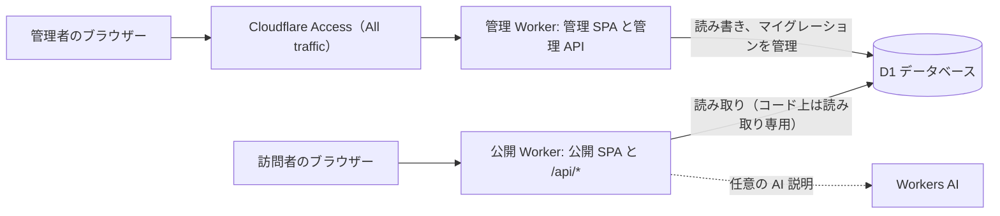
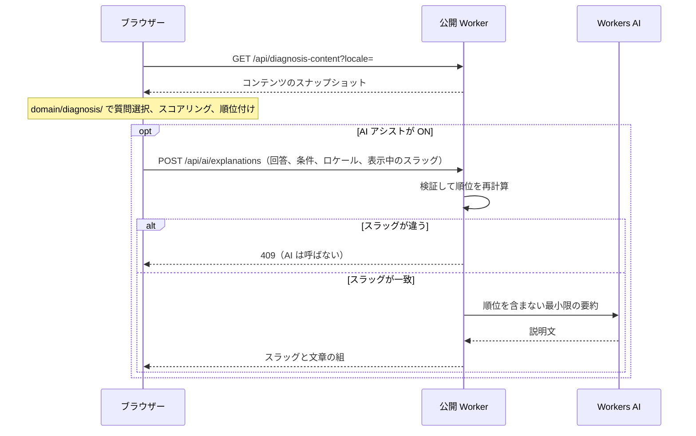

<!-- source: docs/en/ARCHITECTURE.md blob 6fb351fe965396908dd179dfcc5b7d7d5e7314cc -->
[English](../en/ARCHITECTURE.md) | 日本語 · [目次に戻る](README.md)

> この文書は[英語版](../en/ARCHITECTURE.md)の翻訳。内容が異なる場合は英語版が優先する。

# アーキテクチャ — Travel Discovery

Travel Discovery は 2 つの Cloudflare Worker で動く。公開用の Worker と、Access で保護した管理用の Worker で、1 つの D1 データベースを共有する。ここでは Worker の構成、論理レイヤー、リクエストの流れ、管理者認証、AI との境界、プライバシーを説明する。これらの境界をまたいでコードを変える人向けの文書だ。ソースの構成は [DEVELOPMENT.md](DEVELOPMENT.md)（「Project layout」）にある。

## 1. アーキテクチャの概要

2 つの Cloudflare Worker が 1 つの D1 データベースを共有する（判断: [DECISIONS.md](../working/DECISIONS.md)（英語のみ） ADR-001、ADR-004、ADR-018）。

| Worker | 提供するもの | アクセス保護 | D1 の使い方 |
|---|---|---|---|
| 公開 Worker | 公開 SPA（静的アセット）、`/api/*` の公開読み取り API、任意で使う AI 説明エンドポイント（Phase 4、ADR-026） | なし（公開サイト） | 読み取り専用。ただし**コードの構造とテストで守っているだけ**で、DB レベルの権限ではない |
| 管理 Worker | 管理 SPA（静的アセット）と管理 API | すべての URL に Worker レベルの Cloudflare Access（"All traffic"）。さらに管理 API のすべてのハンドラーで JWT を検証 | 読み書き。マイグレーションを管理する |

どちらも TypeScript + React + Vite のアプリで、Cloudflare の Vite プラグインでビルドする。設定は別々（`vite.config.ts` + `wrangler.jsonc`、`vite.admin.config.ts` + `wrangler.admin.jsonc`）で、出力先も別々（`dist/`、`dist-admin/`）だ。公開 Worker には管理用の編集機能を入れない。ソースの構成とモジュールの境界は [DEVELOPMENT.md](DEVELOPMENT.md)（「Project layout」）にある。

構成要素:
- React + TypeScript + Vite。
- 各 SPA のルーティングに React Router（data mode）。
- `ja`・`en`・`es` の型つきメッセージカタログを持つ i18next + react-i18next（ADR-012）。
- UI に Tailwind CSS と shadcn/ui。
- 控えめなトランジションに Motion for React。
- API エンドポイントとサーバー側のロジックに Cloudflare Workers。
- コンテンツデータに Cloudflare D1。
- スキーマとクエリに Drizzle ORM 0.45.x（安定版の系列）。SQL マイグレーションは Wrangler で適用する（ADR-003）。
- 実行時の入出力の検証に Zod。
- 小さなアダプターのインターフェースの裏に置く、任意のプロバイダーとしての Workers AI。
- 単体・結合テストに Vitest、E2E に Playwright。
- lint、型チェック、テスト、ビルドに GitHub Actions。

バージョンや互換性を記憶に頼って決めない。雛形を作る前に現行の公式ドキュメントを確かめ、判断を [DECISIONS.md](../working/DECISIONS.md)（英語のみ）に記録する。

## 2. 論理レイヤー

### UI
- 公開のランディングページ。
- クイズの流れ。
- 結果ページ。
- 管理コンソール（管理 Worker だけが提供）。日本語・英語・スペイン語にローカライズする。
- AI アシストのトグルと、操作を妨げない利用可否・エラーのメッセージ。

### ドメインロジック（純粋な TypeScript）
- 質問の候補の選択。
- 適応的な次の質問の選択。
- 回答の検証。
- 旅行先のハードフィルターと好みのスコアリング。
- 順位付け、正規化、決定的な同点処理。
- フォールバック説明の生成。

ドメインロジックは React、Cloudflare のバインディング、データベースクライアント、AI SDK を import してはならない。ネットワークやデータベースなしでテストできるようにする。

### アプリケーション／サービス
- 有効な質問と旅行先を読み込む。
- クイズと推薦のユースケースを実行する。
- AI 説明のリクエストは、明示的に有効にされたときだけ扱う。
- すべての外部入力とモデルの出力を検証する。

### データアクセス
- D1 のリポジトリ／クエリ層。両方の Worker が使う共有の読み取りモジュールと、管理専用の書き込みモジュールに分ける。
- Drizzle のスキーマ。マイグレーションは管理 Worker の設定が受け持つ。
- シードのスクリプト・データ。
- ブラウザーに DB への直接アクセスを決して見せない。

### インフラストラクチャ
- Worker のルートとミドルウェア。
- 管理者のアクセス制御（管理 Worker だけ）: Access の JWT を検証するミドルウェア。
- AI プロバイダーのアダプター。
- レート制限と安全なエラー処理。
- デプロイの設定。

## 3. リクエストの流れ

### 診断
スコアリングはブラウザーで動く（[DECISIONS.md](../working/DECISIONS.md)（英語のみ） ADR-022）。サーバーはコンテンツを返すだけで、ユーザーが選んだときだけ AI ノートも返す。

1. **コンテンツを読み込む。** ユーザーがクイズを始めると、クライアントは `GET /api/diagnosis-content?locale=` からコンテンツのスナップショットを 1 つ読み込む（公開済みのコンテンツ、スコアリング用のデータ、クイズの設定）。レスポンスは HTTP ではキャッシュしない。クライアントがメモリ上で最大 5 分間使い回す。
2. **状態はメモリに置く。** クライアントは旅行の条件、回答、シードをメモリ上だけに持つ。サーバーには何も保存せず、再読み込みするとクイズは最初からになる。AI アシストが OFF ならサーバーにも何も送らない。ON の場合は手順 4。
3. **ブラウザーで順位を決める。** クライアントは `domain/diagnosis/`（[DIAGNOSTIC_ALGORITHM.md](DIAGNOSTIC_ALGORITHM.md)）で質問の選択、スコアリング、順位付けをする。結果は決定的な説明とともに表示する。
4. **任意の AI ノート**（Phase 4、ADR-026、提案）。AI アシストが有効なら、クライアントは回答、条件、ロケール、表示中のスラッグをつけて `POST /api/ai/explanations` を 1 回送る。
   - Worker はそれらを検証し、同じドメインモジュールで現在の公開コンテンツから順位を計算し直す。
   - スラッグが違えば、AI を呼ばずに `409` を返す。
   - 一致すれば、順位を含まない最小限の要約を Workers AI に送り、それらの旅行先の分だけ `{ slug, text }` の組を返す。
   - クライアントが送った順位は決して信用せず、何も保存しない。
5. **説明を表示する。** AI が OFF か失敗したら、決定的な説明だけを表示する。AI が成功したら、その文章を決定的な説明の隣に、ラベルつきの追加の段落として表示する。

個々の回答の履歴を D1 に保存しない。

### 管理
1. 管理者が管理 Worker の URL を開く。リクエストが Worker に届く前に、Cloudflare Access（Worker レベル、"All traffic"）がログインを求める。これはその Worker のすべてのホスト名に効く。
2. 管理 API のリクエストは、Worker の中でも `Cf-Access-Jwt-Assertion` の JWT（署名、発行者、オーディエンス）を検証して認可し直す。失敗したときや設定がないときは 403。
3. API はペイロードを検証して D1 に書き込む。
4. 変更が公開エンドポイントから見えるのは、検証と公開（`status = 'published'`）が成功した後だけ。

## 4. 管理者認証

判断（オーナー承認済み、ADR-004）: Worker レベルの Cloudflare Access で保護した独立の管理 Worker にし、管理 API のすべてのハンドラーで JWT を検証する。

- Worker レベルの Access は、管理 Worker のすべての URL（`workers.dev`、Version URL、ルート、カスタムドメイン）を覆う。だからその Worker に保護されていない別の URL はない。管理用のホスト名に当たる、Bypass ポリシーつきのホスト名／パス単位の Access アプリを足さない。
- 静的アセットを持つ Worker は `ctx.access` を受け取らない。だから管理 API が自分で JWT を検証し（`jose`、チームの JWKS、発行者、AUD）、失敗したら拒否する。
- 公開 Worker には管理用のルートも書き込みのコードもない。公開側の設定を誤っても、管理機能は表に出ない。
- 自前のパスワードの仕組みを作らない。
- 何が実装済みか、何がテスト済みか、何が承認済みのデプロイの後でしか確かめられないかは、[DECISIONS.md](../working/DECISIONS.md)（英語のみ）の「Admin authentication status」で追う。

## 5. AI プロバイダーの境界

AI プロバイダーは小さなインターフェース（例: `RecommendationExplanationProvider`）の裏に置く。そのメソッドは検証済みの旅行先のコンテンツと短い好みの要約を受け取り、検証済みの説明データを返す。

ドメインのスコアリングエンジンはこのインターフェースに依存してはならない。Workers AI のアダプターは任意で、差し替えられる。次を含める:
- 入力の長さの上限、
- 出力のスキーマ検証、
- プラットフォームに合ったタイムアウト・エラー処理、
- リクエストの予算／レート制限、
- 安全なフォールバック、
- プロンプトやログに生の秘密情報や不要な個人データを入れないこと。

旅行先の説明やユーザー入力を、信頼できる指示として扱わない。プロンプトでは、モデルは編集者・説明役であり、順位を決めるエンジンでも事実の情報源でもないと明示する。

Phase 4 の設計（ADR-026、提案）:
- **モジュール。** `server/ai/` にインターフェース、Workers AI のアダプター、プロンプトの組み立て、出力の検証を置く。`server/public/ai-explanations.ts` にユースケースを置く。ドメインに加わるのは、純粋な好みの要約関数だけ。
- **モデルが見るもの。** スラッグ順に並べた不透明な ID（`d1` など）だけ。スラッグ、順位、スコア、費用、ユーザーの回答は見せない。ID はサーバーがスラッグに戻す。
- **出力のチェック。** 形、ID の集合、長さ、数字・URL・マークアップ、文字体系のチェックは補助的なガードだ。文章が事実として正しいことは証明できない。順位と事実の項目は、決定的なエンジンと人が書いたコンテンツが受け持つ。
- **利用量の上限。** MVP にはアプリ全体の 1 日の予算はない。利用量は次で抑える:
  - 停止スイッチ（`AI_ASSIST_ENABLED`）
  - バーストのレートリミッター（Rate Limiting バインディング、ベストエフォート）
  - Durable Object による利用者ごとの厳密な上限（アドレスごとに 60 秒に 5 回、UTC の 1 日に 30 回。ADR-029）
  - Workers AI の 1 日の割り当て
- **UI での状態と上限の表示**（Phase 14、ADR-026「Phase 14 amendments」）:
  - `GET /api/ai/status` は、そのデプロイがそもそも AI を提供しているか（停止スイッチ、プロバイダー、上限のバインディング）を計画の画面に伝える。D1、リミッター、モデルには触れない。
  - AI が止まっている間は、トグルを無効にする。
  - 429 は、達した上限（`window` か `daily`）と、いつまた試せるかを示す。
  - UI はトグルの横に上限を書く。

## 6. データと API の原則

- 必要に応じて、安定した ID／スラッグ、外部キー、制約、インデックスを使う。
- 公開の読み取りエンドポイントと、管理の変更エンドポイントを分ける。
- 公開 UI に必要な項目だけを返す。
- 公開エンドポイントから管理用のメタデータや非公開のバインディングを決して見せない。
- API の境界でスキーマ検証をする。
- マイグレーションと再現できるシードデータを使う。
- 際限のない一覧エンドポイントを避ける。必要なら管理画面の一覧をページングする。
- クライアントには一般的なエラーを返し、サーバーログは管理下に置く。エラーレスポンスは ADR-015 のステータスコードの取り決め（`{ "error": "<stable_code>" }`、内部の詳細なし）に従う。
- 公開 Worker は D1 に決して書き込んではならない（ADR-018）。
  - 扱うのは `GET`／`HEAD` と、ADR-026 で提案した読み取り専用の `POST /api/ai/explanations` ルート 1 つだけ。
  - これはコードの構造（読み取りと書き込みのモジュールの分離）、lint の import 制限、テストで守っている。データベースレベルの読み取り専用権限では**ない**。D1 には読み取り専用のバインディングがないので、公開 Worker のバインディングでも技術的には書き込める。
  - 必要になったときの代替策として、より強い分離（サービスバインディングの裏に置いた非公開の読み取り専用コンテンツ Worker）を文書化してある。

## 7. 国際化

- ロケールの辞書・リソースを、UI コンポーネントやドメインロジックから分ける。
- 安定した型つきの翻訳キーと、一貫したフォールバック方針を使う。
- コンテンツの翻訳は、安定したエンティティの ID／スラッグとは別に `*_translations` テーブルに置く（[DATA_MODEL.md](DATA_MODEL.md) 参照）。翻訳がないときは `ja → en`、`en → ja`、`es → en → ja` の順にたどる（ADR-012）。
- 選んだロケールは公開 UI と管理 UI の両方で使えるようにする。言語を変えたら文書の言語メタデータも更新する。
- 日付、数値、通貨は、ロケールに対応したプラットフォームの API で書式を整える。
- 必要で文書化してある場合を除き、ロケールの設定を第三者に送らない。

## 8. 可観測性とプライバシー

**ログ。** MVP にアナリティクスはいらない。ログに残すのは運用上のエラーと、役立つなら大まかな AI の利用・失敗の件数だけ。回答全体や機微なユーザーのテキストはログに残さない。ログの保持期間と、プロバイダーとのデータの流れを文書にする。

デプロイした Worker では、Workers Logs の呼び出しログ（invocation logs）を無効にしている。有効にすると、各リクエストの IP アドレス、ヘッダー、位置情報が保存されるからだ。残るのはアプリ自身が出す行だけで、Workers Free では 3 日、2026-12-01 からは 7 日保持される（[DECISIONS.md](../working/DECISIONS.md)（英語のみ）「Phase 7 verification log」）。

**外部の画像。** 旅行先は、管理コンソールで入力した `https` の画像 URL を参照できる。ブラウザーはそのホストから直接読み込むので、そのホストには訪問者の IP アドレスとユーザーエージェントが見える。アプリはそのホストにリファラーを送らず（`referrerPolicy="no-referrer"`、ADR-017）、Cookie も送らない。自分たちのオリジンに置いた画像か、プライバシー条件を受け入れられるプロバイダーの画像を優先する。プロバイダーを足したら記録する。

**AI のデータの流れ**（ADR-026、提案）。AI Gateway は使わない。
- AI が ON のとき、アプリの Worker は 1 回のリクエストで回答（ID）、条件、表示中のスラッグを受け取る。
- Workers AI が受け取るのは、好みの要約（属性名）と、推薦した旅行先の人が書いた説明だけ。
- どちらも内容を保存しない。
- AI エンドポイントがログに残すのは、結果、モデル、レイテンシー、件数だけ。不正な出力のときは、落ちたチェックを示す固定のコードも残す。

## 9. デプロイ

- ローカル開発は、ローカルの D1 バインディングとシードしたテストデータで動くようにする。公開 Worker と管理 Worker は 1 つのローカル D1 の状態を共有しなければならない。
- Workers Free から始める（ADR-015）。上限のエラーでは機能を穏やかに縮退させる。プランを黙ってアップグレードしてはならない。
- プレビュー環境と本番環境は分けなければならない。
- 本番の秘密情報は、プラットフォームの secret の仕組みで設定する。
- AI の設定（`ai` とレート制限のバインディング、`AI_ASSIST_ENABLED`、`AI_MODEL`）は、ビルド時に `CLOUDFLARE_ENV` で選ぶ名前つきのデプロイ環境にだけ置く。ローカル開発とテストが使うトップレベルの設定には決して置かない（ADR-026「Stage 5 preparation decisions」、C）。
- `.dev.vars` と `.env` を Git に入れない。
- プレースホルダーだけを入れた `.env.example` を用意する。
- データベースの作成、マイグレーション、シードの手順、Access の設定、デプロイを文書にする。
- オーナーの明示的な承認なしに、デプロイ、外部リソースの作成、有料機能の有効化、カスタムドメインの設定をしない。
