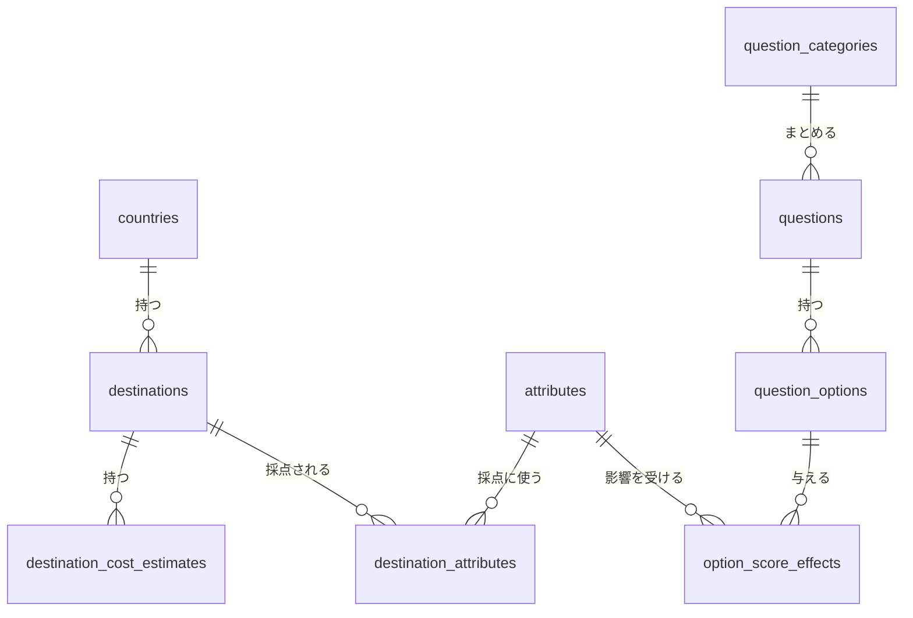

<!-- source: docs/en/DATA_MODEL.md blob 5f7acae7ee4b03e0c7ac389acf92ce28eeace580 -->
[English](../en/DATA_MODEL.md) | 日本語 · [目次に戻る](README.md)

> この文書は[英語版](../en/DATA_MODEL.md)の翻訳。内容が異なる場合は英語版が優先する。

# データモデル — Travel Discovery

D1 に保存するコンテンツデータを説明する。エンティティ、その関係、ローカライズ用のテーブル、設計ルールを扱う。スキーマ、管理 API、シードデータを変える人向けの文書だ。具体的なスキーマは `server/db/schema.ts` にあり、下の論理モデルとの違いは「Phase 1 のスキーマに関する注記」と「Phase 2 のスキーマに関する注記」にまとめてある。

これは初期の論理モデルだ。Claude Code は、現在の D1／ORM の互換性を確かめたうえで、これを具体的なスキーマ、制約、インデックス、マイグレーションに落とし込む。

**ローカライズのルール。** ベーステーブルには、ロケールに依存しないデータ（ID、スラッグ、列挙値、数値、URL、日付）だけを置く。ユーザーに見える文字列はすべて `*_translations` テーブルに置く。キーは `(entity_id, locale)` で、`locale` は `ja`／`en`／`es`／`fr` のどれか。翻訳がないときのフォールバックは [DECISIONS.md](../working/DECISIONS.md)（英語のみ、ADR-012）で決めている。

## 全体の図

ベーステーブルとその関係を示す。ユーザーに見えるテキストを持つテーブルには `*_translations` テーブルもあるが、図では省いた。`app_settings` はどのテーブルとも関係しない。

## エンティティ

### countries
- `id`: 安定した主キー
- `slug`: 一意で安定したスラッグ
- `created_at`, `updated_at`

### country_translations
- `country_id`
- `locale`: `ja` / `en` / `es` / `fr`
- `name`
- 複合主キー `(country_id, locale)`

### destinations
- `id`: 安定した主キー
- `slug`: 一意で安定したスラッグ
- `country_id`: 外部キー
- `destination_type`: city / region / island / その他の対応する列挙値
- `recommended_days_min`, `recommended_days_max`
- `best_months_mask`: 旅行に適した月を構造化したもの（Phase 2、ADR-021）
- 目安の費用は `destination_cost_estimates` に置く（Phase 2、ADR-021）
- `image_url`, `image_attribution`
- `flight_search_config` / `hotel_search_config` は、安全で、文書化してあり、必要な場合だけ。それ以外はアプリのコードで既知の安全な URL を生成する
- `status`: draft / published / archived
- `created_at`, `updated_at`

### destination_translations
- `destination_id`
- `locale`: `ja` / `en` / `es` / `fr`
- `name`
- `summary`
- `highlights`（正規化した子テーブルか検証した JSON。どちらにしたかは文書化する）
- `cautions`
- `best_season_text`
- `image_alt`
- 複合主キー `(destination_id, locale)`

### destination_cost_estimates（Phase 2）
- `id`
- `destination_id`
- `currency`: `JPY` / `USD` / `EUR`。旅行先ごとに一意
- `period`: `per_day` / `per_trip`
- `scope`: 安定した列挙値（例: `per_person_excluding_international_flights`）。ラベルは UI のメッセージカタログでローカライズする
- `min`, `max`
- `source_name`, `source_url`
- `updated_at`（日付）

### destination_cost_estimate_translations（Phase 2）
- `estimate_id`
- `locale`: `ja` / `en` / `es` / `fr`
- `basis`: 概算に何が含まれ、何を前提にしているかの説明
- 複合主キー `(estimate_id, locale)`

### attributes
- `id`
- `slug`: 一意
- `status`

### attribute_translations
- `attribute_id`
- `locale`: `ja` / `en` / `es` / `fr`
- `name`
- `description`（任意）
- 複合主キー `(attribute_id, locale)`

### destination_attributes
- `destination_id`
- `attribute_id`
- `score`: 初期の尺度は 0〜5
- 複合主キー `(destination_id, attribute_id)`

### question_categories
- `id`
- `slug`: 一意
- `status`

### question_category_translations
- `category_id`
- `locale`: `ja` / `en` / `es` / `fr`
- `name`
- 複合主キー `(category_id, locale)`

### questions
- `id`
- `slug`: 一意
- `category_id`、またはカテゴリーのスラッグ／参照
- `question_type`: single_choice / multiple_choice / range
- `priority_weight`
- `status`: draft / published / archived
- `selection_tags` または明示的な条件（小さく、検証したルールの集合に限る）
- `display_order`（任意）
- `created_at`, `updated_at`

### question_translations
- `question_id`
- `locale`: `ja` / `en` / `es` / `fr`
- `prompt`
- `description`（任意）
- 複合主キー `(question_id, locale)`

### question_options
- `id`
- `question_id`
- `value`
- `display_order`
- `status`

### question_option_translations
- `option_id`
- `locale`: `ja` / `en` / `es` / `fr`
- `label`
- 複合主キー `(option_id, locale)`

### option_score_effects
- `option_id`
- `attribute_id`
- `weight`: 符号つきの数値の効果。範囲は文書化して検証する
- 複合主キー `(option_id, attribute_id)`

### app_settings
- `key`
- `value_json`
- `updated_at`
- `updated_by` は、検証済みの管理者の身元が得られて、必要な場合だけ

## 関係
- 1 つの国は多くの旅行先を持つ。
- 1 つの旅行先は 1 つの国に属する。
- 旅行先と属性は `destination_attributes` を介した多対多。
- ローカライズしたテキストは、安定した ID やスコアリング用のデータとは別に保存する。
- 1 つの質問は多くの選択肢を持つ。
- 選択肢と属性は `option_score_effects` を介した多対多。
- 質問はカテゴリーに属する。
- 全体設定はキー／値の設定で、キーごとにスキーマで検証する。

## 設計ルール
- 他から参照されるレコードは、物理削除より論理的なアーカイブを優先する。
- 公開の一覧、状態、スラッグ、結合のために外部キーとインデックスを足す。
- 範囲と関係は API の境界で検証し、できる場所では DB の制約でも検証する。
- タイムスタンプの形式をそろえる。API の境界では UTC の ISO 8601 にし、DB には互換性のある保存形式を使う。
- MVP ではユーザーの回答を永続的なテーブルに保存しない。
- 質問の条件に、任意の実行可能な式や JavaScript を保存しない。小さく型つきの条件の形式を使う。
- JSON の項目を選んだら、トレードオフを文書にし、実行時に検証する。
- 公開するシードのコンテンツには、人が整えた `ja`・`en`・`es`・`fr` の翻訳を必ずそろえる。管理者が入力した不完全なコンテンツには、文書化したフォールバックを適用する。
- 金額は整数の補助単位か、はっきり定義した整数の単位で保存する。明示的な換算のメタデータなしに通貨を混ぜない。
- 費用のレコードには、対象範囲、基準、出典、更新日を必ず入れる。
- 外部リンクは安全に生成し、許可リストか固定のテンプレートで検証する。

## シードデータ
体験を見せられるだけのサンプルコンテンツを作る。ただし、裏付けのない細かすぎる事実は避ける。旅行先 30〜50 件、質問 30〜50 問程度にするのは、品質と出所を保てる場合だけ。小さく整えたデータから始めて、後で増やしてもよい。

シードする旅行先には、目安の費用の出典・基準を入れるか、費用が例示で未検証だと明記する。シードの値を現在のリアルタイム価格として見せない。

## Phase 1 のスキーマに関する注記

具体的なスキーマは `server/db/schema.ts`（Drizzle ORM 0.45）と、`migrations/` に生成したマイグレーションだ。上の論理モデルからの調整とその理由:

- **ID とタイムスタンプ**: 整数の自動採番の主キー（内部用。公開 API はスラッグだけを使う）。`created_at`／`updated_at` はアプリが書き込む UTC の ISO 8601 のテキスト。`cost_updated_at` は ISO の日付（`YYYY-MM-DD`）。
- **状態の値**:
  - 旅行先と質問は `draft / published / archived`。
  - 属性、質問カテゴリー、質問の選択肢は `active / archived`。
  - 国には状態がない（参照データで、削除しない）。
  - 許可する値は CHECK 制約で守る。
- **翻訳**: ユーザーに見える文字列をすべてローカライズするため（上のローカライズのルール参照）、`country_translations`、`attribute_translations`、`question_category_translations` を足した。`locale` は `ja`、`en`、`es` に制約する（`fr` は、7 つの翻訳テーブルを作り直すマイグレーション `0002` で足した。ADR-032）。
- **見どころ**: 子テーブルではなく、検証した文字列の JSON 配列（`destination_translations.highlights_json`、最大 8 項目、各 200 文字）で保存する。トレードオフ: 短い順序つきリストの読み書きが簡単になる。書き込み時と読み込み時に Zod で検証する。
- **目安の費用**（*「Phase 2 のスキーマに関する注記」で置き換え済み*）:
  - `cost_min`／`cost_max` は `cost_currency`（ISO 4217 のコード）の整数の単位。目安の範囲に補助単位の精度はいらない。
  - CHECK 制約で、費用の項目群（最小、最大、通貨、対象範囲、出典名、更新日。出典 URL は任意）を全部入れるか全部空にするかのどちらかにし、`0 <= cost_min <= cost_max` とする。
  - 費用を設定するときは、入力したすべての翻訳に `cost_basis` を入れる（API で検証）。
  - `cost_scope` は安定した列挙値で、ラベルは UI でローカライズする。
- **画像**: `image_url` と `image_attribution` は旅行先に、`image_alt` は翻訳ごとに持つ（画像を設定したら、入力した各翻訳で必須）。URL は `https` でなければならない。
- **尺度**:
  - `destination_attributes.score` は 0〜5 の整数。
  - `option_score_effects.weight` は −5〜5 のゼロ以外の整数（初期の範囲。スコアの計算式を文書化する Phase 2 で見直すかもしれない）。
  - `questions.priority_weight` は 1〜10 の整数（既定は 5）。
- **質問タイプ**: 実装しているのは `single_choice` と `multiple_choice` だけで、Phase 2 からはどちらも公開できる（[DECISIONS.md](../working/DECISIONS.md)（英語のみ） ADR-021）。論理モデルの `range` は実装していない。範囲のある唯一の数値入力である予算は、旅行の条件として扱うからだ（ADR-021）。後で足すなら、CHECK 制約を広げるマイグレーションになる。
- **選択の条件**: 保存しない。Phase 2 の質問選択は、質問ごとの条件ではなく、属性のカバー状況で適応する（[DIAGNOSTIC_ALGORITHM.md](DIAGNOSTIC_ALGORITHM.md) §7）。
- **選択肢**: 質問ごとに `value`（安定したスラッグ）で一意なので、更新では value で選択肢を対応づける。管理画面の更新で省いた選択肢は、削除ではなくアーカイブする。
- **設定**: `app_settings` は `quiz` キー（検証済みの JSON）を保存する。[DECISIONS.md](../working/DECISIONS.md)（英語のみ） ADR-020 を参照。
- **削除**: API による物理削除はしない。外部キーの `ON DELETE CASCADE` は、親の行からその翻訳・子の行への参照にだけ使う。独立したエンティティ同士の参照には `RESTRICT` を使う。

## Phase 2 のスキーマに関する注記

マイグレーション `0001`（判断: [DECISIONS.md](../working/DECISIONS.md)（英語のみ） ADR-021、アルゴリズム: [DIAGNOSTIC_ALGORITHM.md](DIAGNOSTIC_ALGORITHM.md)）:

- **費用の概算**:
  - `destinations` の費用の列を `destination_cost_estimates` に置き換えた。`destination_translations.cost_basis` は `destination_cost_estimate_translations.basis` に置き換えた。
  - 概算は `(destination_id, currency)` ごとに最大 1 件。`currency` は `JPY`、`USD`、`EUR`（`shared/costs.ts`）。`period` は `per_day` か `per_trip`。`min`／`max` は通貨の整数の単位で、`0 <= min <= max`。
  - 旅行先が翻訳を持つすべてのロケールで、各概算の basis が必要（API で検証）。
  - 概算は、旅行先の集約の `PUT` の一部として置き換える。
- **旅行に適した月**: `destinations.best_months_mask` は `NULL`（不明）か 1〜4095。ビット `m − 1` が立っていれば、`m` 月は旅行に適した月だ。API ではソートした月のリストとしてやり取りする（`shared/months.ts`）。
- **マイグレーションの安全性**: `destinations` の作り直しでは、ID、翻訳、属性スコアを保つ（ADR-021 参照）。以前の単一通貨の費用の値は捨てる。
