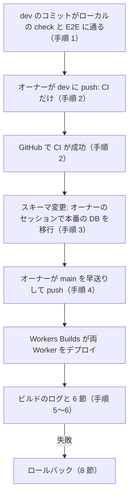

<!-- source: docs/en/DEPLOYMENT.md blob 095b1ac8e602c709595dfe4717a8c0077608e6ff -->
[English](../en/DEPLOYMENT.md) | 日本語 · [目次に戻る](README.md)

> この文書は[英語版](../en/DEPLOYMENT.md)の翻訳。内容が異なる場合は英語版が優先する。

# デプロイ手順書

Cloudflare 上の本番の Worker について、準備、マイグレーション、ビルド、デプロイ、確認、ロールバックの手順をまとめる。コードが Cloudflare に届く経路は、Cloudflare の Git 連携である Workers Builds だけだ。オーナーが `main` に push すると本番にデプロイされる。`dev` への push では CI だけが走る。オーナーと、オーナーのためにデプロイを準備する人向けの文書だ。AI の有効化は [AI_ENABLEMENT.md](AI_ENABLEMENT.md)、デプロイしたアプリの運用は [OPERATIONS.md](OPERATIONS.md) にある。

> [!WARNING]
> `main` への push は本番にデプロイする。それ以外のリモートの手順（D1 のマイグレーション、Time Travel、コマンドでのロールバック、秘密情報、Access、ダッシュボードの設定）はすべてオーナーの手順だ。Claude はコマンドとチェックを用意するが、承認があっても自分では実行しない。

コマンドは Phase 6（2026-10-18）に、現行の公式ドキュメントと照らし合わせた（[DECISIONS.md](../working/DECISIONS.md)（英語のみ）「Phase 6 verification log」）。Workers Builds は 2026-10-31 に確かめた（ADR-033）。*(要確認)* の印がある項目は文書に書かれていないので、その手順の時点で確かめる。これまでに何をデプロイしたかは 11 節にある。

## 1. 目標の構成

| | 公開 Worker | 管理 Worker |
|---|---|---|
| 設定 | `wrangler.jsonc` | `wrangler.admin.jsonc` |
| 提供するもの | 公開 SPA、読み取り専用 API、AI 説明エンドポイント | 管理 SPA と管理 API |
| 保護 | なし（公開サイト） | Worker レベルの Cloudflare Access（"All traffic"）と、管理 API のすべてのハンドラーでの JWT 検証（ADR-004） |
| D1 | 管理 Worker と同じデータベース。コード上は読み取り専用（ADR-018） | マイグレーションを管理する |
| 任意のバインディング | `AI`、`AI_CLIENT_RATE_LIMITER`（ADR-026）、Durable Object `AI_CLIENT_LIMITER`（ADR-029。AI には必須） | `ADMIN_RATE_LIMITER`（ADR-020） |

デプロイする環境は `production` の 1 つで、専用の D1 データベースを持つ。名前つきの環境は、その環境が自分の `name` を設定しない限り、`<name>-<environment>` という別の Worker としてデプロイされる:

| 環境 | デプロイする Git ブランチ | 公開 Worker | 管理 Worker | D1 データベース |
|---|---|---|---|---|
| `production` | `main` | `travel-discovery`（`env.production` が `name` を設定。オーナーの判断、2026-10-18） | `travel-discovery-admin`（同様） | `travel-discovery-production` |

- 両方の Worker は Workers Builds でこのリポジトリにつながり、5 節のブランチ、ビルドコマンド、デプロイコマンドを持つ。
- 2026-10-18 から 2026-10-31 までは `preview` 環境（`travel-discovery-preview`、`travel-discovery-admin-preview`、データベース `travel-discovery-preview`）もあった。用途はローカルのチェックと本番のチェックで足りるので外した（ADR-033「Amendment 2026-10-31」）。Cloudflare 上のリソースはオーナーが消す（3.7）。
- 本番の前の確認はローカルで行う。`npm run check`、`npm run test:e2e`、危ないマイグレーションでは本番のローカルコピーでのリハーサルだ（4 節）。
- Worker の名前で `workers.dev` の URL（`<worker>.<account subdomain>.workers.dev`）が決まる。
- トップレベルの設定はローカル専用のまま。`npm run dev`、テスト、E2E が使う。
- `wrangler.admin.jsonc` の `env.e2e` はローカルのテスト用で、決してデプロイしない。

## 2. 誰が何をするか

- **Claude** はコミット、コマンド、期待する出力、チェックを用意する。デプロイはしない。Cloudflare へのログインが要るコマンドは実行せず、ログインもログアウトもせず、ダッシュボードも開かない。
- **オーナー** は `dev` と `main` に push し（`main` への push はどれもデプロイになる）、ダッシュボードの手順とオーナーのセッション（3.1）をすべて受け持つ。
- 次の項目はそれぞれ別のオーナーの判断だ。新しい環境ではこの順に進める:
  1. ダッシュボードでのアカウントのプランの確認（Workers Free。支払い方法が登録されているか）。
  2. 各 D1 データベースの作成（3.2）。
  3. 設定の変更 C5（3.3）。最初のデプロイの前にコミットする。
  4. 各リモートデータベースへのマイグレーションの適用（4 節）。
  5. Cloudflare Zero Trust の有効化と、各管理 Worker の Access ポリシーの作成（3.4）。
  6. 各 Worker の Workers Builds への接続（3.6）。
  7. `main` への各 push。
  8. 後で AI を有効にするのは別の判断（[AI_ENABLEMENT.md](AI_ENABLEMENT.md)）。

## 3. 初回だけのセットアップ

### 3.1 Wrangler を使うオーナーのセッション
Workers Builds が実行できないリモートのコマンド（D1 の作成とマイグレーション、Time Travel、`wrangler rollback`、秘密情報、新しい Worker の最初のデプロイ）は、オーナーのセッションで実行する。オーナーが自分の端末で実行し、最後にログアウトする。こうしてマシンに Cloudflare のログインを残さない。

1. ログインする。ログインはブラウザーの OAuth で、認証情報はリポジトリではなくユーザーのホームディレクトリに保存される。

   ```bash
   npx wrangler login
   ```

   ```bash
   npx wrangler whoami
   ```

2. その手順のために用意したコマンドを、1 つずつ実行する。
3. 手順に書いたとおりに結果を確かめる。
4. ログアウトし、アカウントが表示されなくなったことを確かめる *(要確認: ログアウト後の `whoami` の正確な表示)*。

   ```bash
   npx wrangler logout
   ```

   ```bash
   npx wrangler whoami
   ```

API トークンは `.dev.vars`、`.env`、リポジトリ内のどのファイルにも決して入れず、GitHub Actions にも足さない。デプロイ用の認証情報は Workers Builds のトークンだけで、これは Cloudflare の中にとどまる（3.6）。Phase 4 の評価用トークンは、すでに削除してあるはずだ（10 節）。

### 3.2 D1 データベース
環境ごとに 1 つ、オーナーのセッション（3.1）で作る:

```bash
npx wrangler d1 create travel-discovery-production
```

- 表示された `database_id` を、**両方の**設定の対応する環境に記録する（C5）。ID は秘密情報ではない。
- ローカルのプレースホルダー `local-travel-discovery` を使い回さない。それでデプロイすると、別のデータベースに触れずに失敗する（ADR-018）。
- `--location`（ロケーションのヒント）は任意。オーナーが選ばない限り指定しない。

### 3.3 設定（C5、ADR-026「Stage 5 preparation decisions」C）
`env.production` は両方の Wrangler の設定にある（Phase 6、2026-10-18）。専用のデータベースと、`namespace_id` の値 `2001`（公開）と `2002`（管理）を持つ。トップレベルの Worker 名を保つために `name` も設定する。`env.preview`（`1001`／`1002`）は 2026-10-31 に外し、その Worker も同じ日に消した（3.7）ので、その ID は空いている。

名前つきの環境は `vars` とバインディングを引き継がないので、環境は使うものをすべて宣言する:
- **両方の Worker:**
  - その環境の `database_name` と `database_id` を持つ `d1_databases`（管理の設定は `migrations_dir` も残す）。
  - `"observability": { "enabled": true, "logs": { "enabled": true, "invocation_logs": false } }`。アプリ自身の行だけを残す Workers Logs だ。呼び出しログは、各リクエストの IP アドレス、ヘッダー、位置情報を保存してしまう（[DECISIONS.md](../working/DECISIONS.md)（英語のみ）「Phase 7 verification log」）。
  - `"workers_dev": true` と `"preview_urls": false`。ダッシュボードの設定が黙ってずれないよう、明示的に書く。
  - `upload_source_maps`。
- **公開 Worker:**
  - `ai` バインディング。
  - `vars` の `AI_ASSIST_ENABLED: "false"` と `AI_MODEL: "@cf/google/gemma-4-26b-a4b-it"`。
  - `ratelimits` バインディング `AI_CLIENT_RATE_LIMITER`（`simple: { limit: 5, period: 60 }`）。
  - Durable Object バインディング `AI_CLIENT_LIMITER`（クラス `AiClientLimiter`）と、マイグレーション `v1`（`new_sqlite_classes`）。ローカルで動かすため、トップレベルにも置く（ADR-029）。
- **管理 Worker:**
  - `ratelimits` バインディング `ADMIN_RATE_LIMITER`（推奨 `limit: 120, period: 60`）。
  - `vars` の `ACCESS_TEAM_DOMAIN` と `ACCESS_POLICY_AUD`。秘密情報ではない。3.4 の後でわかり、管理 Worker ごとに違う。
- **レート制限の名前空間:** `ratelimits` のエントリーにはそれぞれ専用の `namespace_id`（正の整数を文字列にしたもの。アカウント内で一意）が要る。同じ ID のバインディングはカウンターを共有するので、2 つの環境で決して共有しない。

> [!WARNING]
> ローカルの実行に AI の設定を持ち込まない。`ai` バインディングは、`npm run dev` やテストからでも常に Cloudflare に接続する。
> - トップレベルに `ai`、`ratelimits`、AI の変数を決して足さない。
> - `CLOUDFLARE_ENV` にデプロイ環境を設定したまま `npm run dev` や `npm run dev:admin` を決して動かさない。環境向けのビルドの後に `npm run preview` も使わない。どちらもその環境の `ai` バインディングを使ってしまう。
> - `dist/` と `dist-admin/` をローカルの設定に戻すには、`CLOUDFLARE_ENV` なしで `npm run build` を実行する。

設定を変えた後のチェック（ローカル、ログイン不要。最後は `env.preview` を外した後の 2026-10-31 に合格）:
- トップレベルのビルド出力（`dist/worker/wrangler.json`、`dist-admin/admin_worker/wrangler.json`）が、定義した環境の一覧以外は変わらない。
- `CLOUDFLARE_ENV=production npm run build` が、期待どおりに平たくした設定を書き出す。Worker 名 `travel-discovery` と `travel-discovery-admin`、本番のデータベース、期待どおりの `vars` とレートリミッターだ。
- `npm run check` と `npm run test:e2e` が通る。
- `npm run dev` がリモートバインディングの警告を出さない。

### 3.4 各管理 Worker の Cloudflare Access
管理 Worker には、Access なしで決して到達できてはならない。一方で、Worker レベルの Access は存在する Worker にしかかけられない。だから最初のデプロイでは URL を持たせない:

1. 管理 Worker の最初のデプロイは、その環境で `"workers_dev": false`（と `"preview_urls": false`）にして、URL を持たせない。そうした Worker でも Access タブは使える（2026-10-18 に確認）。
   - Workers Builds は存在する Worker にしかつなげない。だからこの最初のデプロイは、ローカルでビルドするオーナーのセッション（3.1）になる。`CLOUDFLARE_ENV=<env> npm run build` の後に `npx wrangler deploy --config dist-admin/admin_worker/wrangler.json` を実行する。
   - Workers Builds への接続（3.6）は、下の手順 5 が通ってからにする。
2. 必要なら Zero Trust を有効にし（ダッシュボード）、チーム名を選ぶ。Free プランの席数の上限とログイン方法（One-time PIN など）はそこで確かめる *(要確認: 文書に書かれていない)*。
3. Worker を保護し、ポリシーをオーナーだけに絞る:
   1. Workers & Pages → 管理 Worker → Access → "Protect this Worker behind Access" → スコープ **All traffic**。
   2. クイックセットアップで選べるのは "Cloudflare account" と "Email domain" のポリシーだけ（2026-10-18 に確認）。**Cloudflare account**（このアカウントのメンバーだけ）を選んで適用する。
   3. Zero Trust → Access controls → Policies を開き、生成された再利用可能なポリシー（`<worker> - Production`）を編集する。Include ルールを、オーナーの完全なアドレスを指定した **Emails** セレクターに変える。
   4. 公開のメールサービスの "Email domain"（そこのすべてのアドレスを通してしまう）、"Everyone" セレクター、"Login Methods: One-time PIN" の Include ルール（PIN を受け取れる人なら誰でも通してしまう）は決して選ばない。
4. AUD タグとチームドメインを、その環境の `ACCESS_POLICY_AUD` と `ACCESS_TEAM_DOMAIN` にコピーする。`"workers_dev": true` にしてコミットし、デプロイする。Worker をつなぐ前なら同じオーナーのセッションで、3.6 の後ならその環境のブランチへの push でデプロイする。この 2 つの値がないと、管理 API のリクエストはすべて 403 になる（失敗時は拒否）。
   - AUD タグ: Zero Trust → Access controls → Applications → その Worker のアプリケーション。文書では Configure → Additional settings → "Application Audience (AUD) Tag" とされているが、ダッシュボードでは違うことがある。
   - チームドメイン: `https://<team>.cloudflareaccess.com`。Zero Trust → Settings で見るか、Zero Trust を有効にしたときのチーム名から導く。
5. Access タブやポリシーを変えたら、必ずスコープ（**All traffic**）と、Worker の `workers.dev` の URL（Settings → Domains & Routes）の両方を確かめる。2026-10-18 には、スコープが "Previews only" になっていたことと、Access の設定を保存した後に URL が無効になっていたことが一度ずつあった。
   - `workers_dev` を有効にしたデプロイの直後に、`/` と `/api/admin/me` に認証なしのリクエストを送る。どちらも `https://<team>.cloudflareaccess.com/...` にリダイレクトしなければならない。
   - `/` が 200 を返したら、[OPERATIONS.md](OPERATIONS.md) 4.2 のとおり、すぐに URL を外す。
6. 管理用のホスト名に当たる、Bypass ポリシーつきのホスト名／パスの Access アプリケーションを作らない（ADR-004 の不変条件 4）。アカウント全体の Worker 保護も使わない。公開サイトまで保護してしまう。

管理 Worker はそれぞれ専用の Access 設定と AUD を持つ。今は `travel-discovery-admin` の 1 つだけだ。

### 3.5 秘密情報
今の Worker には秘密情報が要らない。AI バインディングは何も要らず、Access の値は秘密ではない。後で秘密情報を足すなら、オーナーがダッシュボード（Settings → Variables & Secrets）で設定するか、オーナーのセッション（3.1）で `npx wrangler secret put <NAME>` を使う。ファイル、`.dev.vars`、`.env`、GitHub には決して入れない。デプロイで秘密情報が消えることはない。

Workers Builds にもビルド変数とビルド用の秘密情報があり、ビルドの間だけ使える。このプロジェクトはどちらも使わない。`CLOUDFLARE_ENV` はビルドコマンドに含めるので、設定画面にも各ビルドのログにも表示される（3.6）。

### 3.6 Worker を Workers Builds につなぐ
各 Worker は、オーナーがダッシュボードで 1 回ずつ、1 つずつこのリポジトリにつなぐ。状態: 本番の 2 つの Worker を 2026-10-31 につないだ。最初のビルドがコミット `59b754c` を新しいバージョンとしてデプロイし、6 節も通った（ADR-033「Amendment 2026-10-31」）。下の手順は、Worker をつなぎ直すときや新しい Worker をつなぐときのためのものだ。

**事前に:**
- 請求（オーナー）: Workers のプランが Free で、Billing にはドメインの登録だけが載っている（[OPERATIONS.md](OPERATIONS.md) 3 節）。
- `main` がデプロイしてよいコミットを指していて、その CI が通っている。2026-10-31 に Worker をつないだときは、`main` はまだ `package.json` のない最初のコミットを指していた。そのビルドは何もデプロイできず、`59b754c` の push で最初の本当のビルドが始まった。
- その Worker がすでに存在する（新しい管理 Worker なら 3.4）。

**Worker ごとに**（Workers & Pages → その Worker → Settings → Build → Connect）:
1. Git プロバイダー: GitHub と、このリポジトリ。
   - Cloudflare が GitHub アプリのインストールや権限の追加を求めてきたら、**選んだリポジトリだけ**にアクセスを許し、このリポジトリを足す。my-music-site が使うアプリがすでに入っているかもしれない *(要確認: Workers Builds が同じアプリとリポジトリの一覧を使うか)*。
2. 設定は 5 節の表に合わせる:
   - Git ブランチ: `main`。
   - ビルドコマンドとデプロイコマンドは 5 節のとおりにする。`CLOUDFLARE_ENV=production` の前置きは効く。最初のビルドが本番のバインディングでデプロイした（2026-10-31）。前置きがないと、ビルドはトップレベルの設定を使い、デプロイはプレースホルダーのデータベース `local-travel-discovery` で失敗する（ADR-018）。
   - ルートディレクトリ: 空（両方の Wrangler の設定があるリポジトリのルート）。
   - ビルド変数とビルド用の秘密情報: なし。
   - ビルドの監視パス: オーナーが別に決めない限り既定（すべての変更）のまま（5 節「ビルド時間」）。
3. Branch control で**プレビュービルドを無効にする**（本番以外のブランチのビルド）。
   - 無効にしないと、ほかのブランチへの push で専用の URL を持つ公開の Preview ができてしまう。確認済みの `workers_dev` と Access の構成の外側だ。
   - Worker を新しい Worker Previews の方式に切り替えない。文書によると、この切り替えは元に戻せない（ADR-033）。
4. API トークン: もう一方の Worker が使っているトークンを選ぶ。まだ 1 つもないときだけ、Cloudflare に作らせる。
   - 文書にある権限は、Account Settings の読み取り、Workers Scripts の編集、Workers KV Storage の編集、Workers R2 Storage の編集、全ゾーンの Workers Routes の編集、User Details の読み取り、Memberships の読み取りだ。請求、プラン、支払い、メンバーの権限はどれも含まない。
   - オーナー: My Profile → API Tokens でトークンを開き、権限がちょうどこの一覧であることを確かめる。請求やアカウント管理の権限を持つトークンはインシデントだ。取り消して [DECISIONS.md](../working/DECISIONS.md)（英語のみ）に記録する。
   - トークンは Cloudflare の中にとどめる。ファイル、GitHub、チャットには決してコピーしない。
5. 保存する。保存するとすぐにブランチの先頭のビルドが始まるかもしれない *(要確認)*。だから接続の前に、`main` の先頭がデプロイしてよいコミットであることを確かめ、ビルドを手順 6 のとおり確かめる。
6. その Worker の最初のビルドを確かめる:
   - ビルドのログに、`.nvmrc` の Node.js のバージョン（24） *(要確認: ビルドイメージが Node.js をどう選ぶか)* と、`package.json` の Wrangler のバージョンが出ている。
   - デプロイの段階で、期待する Worker の名前と、期待するバインディングが出ている。本番の D1 データベース、公開 Worker では `AI_ASSIST_ENABLED` が `"false"`、本番の `namespace_id` を持つレートリミッターだ。
   - その Worker の Deployments に、そのコミットの新しいバージョンが出ている。
   - ビルドにかかった時間を控える（5 節「ビルド時間」）。
   - 6 節を実行する。管理 Worker の後は `--watch-admin 120` を足す。

**事後に:**
- 日付、ビルド時間、バージョン ID を [DECISIONS.md](../working/DECISIONS.md)（英語のみ）と 11 節に記録する。
- これまでのローカルからのデプロイでこのマシンに残ったログインは、もう要らない。今ログアウトし、確かめる（3.1 の手順 4）:

  ```bash
  npx wrangler logout
  ```

  ```bash
  npx wrangler whoami
  ```

- 以後、オーナーのセッションは必ず `npx wrangler logout` で終える。こうして、この手順書のどの手順もマシンに Cloudflare のログインを残さない。

### 3.7 プレビューのリソースを消す（オーナー、1 回だけ）
プレビュー環境は 2026-10-31 に設定から外したが、Cloudflare 上のリソースはオーナーが消すまで残る。Workers Free では費用はかからないが、公開側のプレビュー Worker は古いコードとシードデータを公開 URL で出し続ける。状態: 2026-10-31 にオーナーが実施した。その途中で本番の Access アプリケーションも失われ、オーナーが `workers.dev` を無効にするまで、本番の管理 SPA が Access なしで見えていた（ADR-033「Amendment 2026-10-31」のインシデント）。下の手順には、これを見つけられたはずのチェックを入れてある。

どの削除も元に戻せず、オーナーの判断だ。管理のプレビュー Worker が Access なしで届く瞬間を作らないよう、次の順に消す:

1. **先に管理のプレビュー Worker。** Workers & Pages → `travel-discovery-admin-preview` → Settings → Delete *(要確認: 正確な表示名)*。Workers Builds にはつながっていない。
2. **公開のプレビュー Worker。** Workers & Pages → `travel-discovery-preview` → Settings → Delete。Durable Object `AiClientLimiter` のデータも消えるが、中身はアドレスごとの AI のカウンターだけだ。
3. **管理のプレビュー Worker の Access アプリケーション。** 手順 1 の後にだけ消す。Zero Trust → Access controls → Applications → `travel-discovery-admin-preview` のアプリケーション → Delete。
   - 消す前にアプリケーションを開き、ドメインが `travel-discovery-admin-preview.<account subdomain>.workers.dev` で、AUD タグが `wrangler.admin.jsonc` の `env.production` の `ACCESS_POLICY_AUD` ではないことを確かめる。2 つのアプリケーションの名前は `-preview` しか違わない。
   - 手順 1 の後で、アプリケーションがもうないこともある。そのときはこの手順を飛ばす。代わりに別のアプリケーションを消すことは決してしない。
   - 続いて Access controls → Policies で、再利用可能なポリシー `travel-discovery-admin-preview - Production` を、どのアプリケーションも使っていない場合にだけ消す。本番のアプリケーションは専用のポリシーを持つ。
   - その直後に `node scripts/check-deployment.mjs <account subdomain> production --watch-admin 120` を実行する。管理 Worker が 200 を返したらインシデントだ（[OPERATIONS.md](OPERATIONS.md) 4.2）。
4. **プレビューの D1 データベース。** Storage & Databases → D1 → `travel-discovery-preview` → Settings → Delete *(要確認: 正確な表示名)*。中身は `db/seed/dev.sql` のデータと確認用に入れたコンテンツだけなので、エクスポートは要らない。データベースを消すと、Time Travel でも戻せない。
5. **確かめる:**
   - `node scripts/check-deployment.mjs <account subdomain> production --watch-admin 120` が通る。
   - `https://travel-discovery-preview.<account subdomain>.workers.dev/` と `https://travel-discovery-admin-preview.<account subdomain>.workers.dev/` が 200 を返さなくなっている。
   - このアプリの Worker として Workers & Pages に `travel-discovery` と `travel-discovery-admin` だけが、D1 に `travel-discovery-production` だけが載っている。
6. 日付を [DECISIONS.md](../working/DECISIONS.md)（英語のみ）の ADR-033 と 11 節に記録する。以後、`namespace_id` の `1001` と `1002` は使い回してよい。

どれもダッシュボードの手順で、このマシンでのログインは要らない。

## 4. データベースのマイグレーション
マイグレーションは管理の設定からだけ、オーナーのセッション（3.1）で適用する。Workers Builds は適用しない。

> [!WARNING]
> `main` に push するとすぐにデプロイされる。新しいスキーマが要るコードのコミットを `main` に push する**前に**、本番のデータベースにマイグレーションを適用する。

スキーマの変更が要るコミットの順番:

1. マイグレーションが今デプロイしているコードと後方互換である（8 節）。そのコミットでローカルの `npm run check` と `npm run test:e2e` が通っている。どちらも、まっさらなローカルのデータベースにすべてのマイグレーションを適用する。
2. テーブルを作り直したりデータを変えたりするマイグレーションは、先に本番のローカルコピーでリハーサルする（下）。
3. オーナーのセッション: Time Travel のブックマークを記録し、`travel-discovery-production` にマイグレーションを適用し、確かめて、ログアウトする。
4. オーナー: `main` に push する。Workers Builds が両方の Worker をデプロイする。6 節を実行する。

本番のコマンド:

```bash
npx wrangler d1 migrations apply travel-discovery-production --remote --env production --config wrangler.admin.jsonc
```

- Wrangler は未適用のマイグレーションを並べ、確認を求め、適用する前にバックアップを取る。
- 適用する前に、復元ポイントを記録する: `npx wrangler d1 time-travel info travel-discovery-production`。
- スキーマの変更は、前にデプロイしたコードと後方互換にする。コードをロールバックしても、データベースは戻らない（8 節）。
- `db/seed/dev.sql` はローカルのテストデータだ。本番には決して読み込まない。本番のコンテンツは管理コンソールから入れる。

**本番のローカルコピーでのリハーサル（任意）。** 危ないマイグレーションでは、これが以前のプレビューのデータベースの代わりになる。
1. オーナーのセッション: 本番のデータベースを**リポジトリの外**のファイルにエクスポートする。公開済みのコンテンツが入るからだ。ログアウトする。

   ```bash
   npx wrangler d1 export travel-discovery-production --remote --output ~/travel-discovery-backups/production.sql
   ```

2. ローカルで、ログインなしに、別のローカルの状態に読み込み、未適用のマイグレーションを適用する:

   ```bash
   npx wrangler d1 execute travel-discovery --local --persist-to .wrangler/rehearsal --config wrangler.admin.jsonc --file ~/travel-discovery-backups/production.sql
   ```

   ```bash
   npx wrangler d1 migrations apply travel-discovery --local --persist-to .wrangler/rehearsal --config wrangler.admin.jsonc
   ```

3. 前後の行数を比べ、移行したテーブルを確かめる。終わったら `.wrangler/rehearsal` とエクスポートを消す *(要確認: エクスポートした SQL がそのままローカルのデータベースに読み込めるか)*。

## 5. ビルドとデプロイ
Workers Builds は、`main` への push をすべてビルドしてデプロイする。`dev` への push では GitHub Actions の CI だけが走る。各 Worker の設定は次のとおり（3.6）:

| Worker | Git ブランチ | ビルドコマンド | デプロイコマンド |
|---|---|---|---|
| `travel-discovery` | `main` | `CLOUDFLARE_ENV=production npm run build` | `npx wrangler deploy --config dist/worker/wrangler.json` |
| `travel-discovery-admin` | `main` | `CLOUDFLARE_ENV=production npm run build` | `npx wrangler deploy --config dist-admin/admin_worker/wrangler.json` |

どちらも、ルートディレクトリは空、ビルド変数はなし、プレビュービルドは無効だ。`npm run build` は毎回両方の Worker をビルドするので、型チェックとバンドルのチェック（ADR-004）がどのビルドでも走る。



1. `dev` にコミットし、そのコミットでローカルの `npm run check` と `npm run test:e2e` を実行する。
2. オーナー: `dev` に push する。何もデプロイされない。そのコミットで GitHub Actions の CI が成功するまで待つ。Workers Builds はその結果を待たないからだ。
3. コミットにスキーマの変更が要るなら、先に本番のデータベースにマイグレーションを適用する（4 節）。
4. オーナー: `main` を確認済みのコミットまで進めて push する。これで `travel-discovery` と `travel-discovery-admin` がデプロイされる。push するのは CI が通ったコミットだけにし、その上に新しいものを載せない。

   ```bash
   git switch main
   ```

   ```bash
   git merge --ff-only dev
   ```

   ```bash
   git push origin main
   ```

5. ダッシュボードで 2 つのビルドのログを読む（その Worker → Deployments または Builds *(要確認: 正確なタブ)*）:
   - 期待どおりのコマンドでビルドされ、型チェックとバンドルのチェックを含めて `npm run build` が通った。
   - デプロイの段階で、期待する Worker の名前と、期待するバインディングと `vars` が出ている。本番の D1 データベース、`AI_ASSIST_ENABLED`、本番の `namespace_id` を持つレートリミッターだ。
   - このチェックが大事なのは、デプロイする Worker の名前を Workers Builds 自身が設定するからだ（下の「Worker の名前」）。ビルドコマンドを間違えると、正しい名前のまま、トップレベルや別の環境のバインディングでデプロイしてしまうことがある。
6. **両方の**ビルドが終わってから、6 節を実行する。記録しておく価値のあるデプロイなら、バージョン ID を 11 節に記録する。

**注意点:**
- **`main` への push はどれもデプロイになる。** ドキュメントだけを変えたコミットも同じだ。失敗したビルドは何もデプロイせず、前のバージョンが配信され続ける。
- **Workers Free ではビルドは一度に 1 つ。** 2 つの Worker は順にビルドされるので、数分の間、公開 Worker と管理 Worker が別のコミットで動くことがある。スキーマの変更は後方互換で（4 節）、2 つの Worker が共有するのはデータベースだけなので、これは安全だ。
- **ビルドに `.dev.vars` は入らない。** Workers Builds はクリーンなチェックアウトから始めるので、[DEVELOPMENT.md](DEVELOPMENT.md) にある `.dev.vars` のコピーはそこでは起きない。ローカルのビルドでは今も起きる。
- **ダッシュボードでの変数や `workers.dev` の編集**は、これまでどおり次のビルドのデプロイで上書きされる。
- **Worker の名前。** Workers Builds は、ダッシュボード上の Worker の名前が、ルートディレクトリの Wrangler の設定の `name` と一致することを求める。ただし、基本の名前が同じ Wrangler の環境は例外だ。Wrangler v3 以降では、Workers Builds が `WRANGLER_CI_OVERRIDE_NAME` で、つないだ Worker の名前を自分で設定する（Troubleshooting のページ、2026-10-30 更新）。ルートの `wrangler.jsonc` の名前は `travel-discovery` なので、管理 Worker はこの上書きに頼ることになる。2026-10-31 の最初のビルドで新しいバージョンができた *(要確認: `travel-discovery-admin` のバージョン ID を記録するときに確かめる)*。
- **ビルド時間。** Workers Free には、月 3,000 分のビルド時間、同時ビルド 1 つ、20 分のタイムアウトが含まれる。`main` への push 1 回でビルドは 2 回走り、`dev` への push では走らない。1 回のビルドが T 分なら、月に 3,000 ÷（2 × T）回 `main` に push できる。たとえば 4 分なら約 375 回だ。使い切ったときに何が起きるかは文書にない *(要確認)*。そのときは push を止めて月のリセットを待つ。プランは決して上げない。使った時間が枠の半分を超えたら、まずドキュメントだけのコミットを除外するビルドの監視パスを検討する（オーナーの判断）。

**ローカルでのドライラン（任意、ログイン不要）。** push の前に平たくした設定を見たいときは、ローカルでビルドしてドライランを実行する。終わったら `npm run build` でローカルの設定に戻す（3.3）。

```bash
CLOUDFLARE_ENV=production npm run build
```

```bash
npx wrangler deploy --dry-run --config dist/worker/wrangler.json
```

```bash
npx wrangler deploy --dry-run --config dist-admin/admin_worker/wrangler.json
```

- ドライランはバインディングと `vars` を出すが、Worker の名前は出さない。名前は同じ `wrangler.json` の `name` 項目にある。
- `--config` のパスは必ず明示する。ビルドはリダイレクト用のファイルも書き出す。公開のビルドは `.wrangler/deploy/config.json`、管理のビルドは `admin/.wrangler/deploy/config.json` だ（管理の Vite のルートが `admin/` のため）。2026-10-18 に Wrangler 4.151.1 で確認したこと:
  - リポジトリのルートでただ `npx wrangler deploy` を実行すると、リダイレクトに従って**公開 Worker だけ**をデプロイする。
  - `--config <生成された wrangler.json>` を指定すると、リダイレクトは使われない。
  - `--cwd admin` は失敗する。リダイレクト用のファイルがユーザーの設定の隣にないからだ。
- `CLOUDFLARE_ENV` はビルド時に Vite プラグインが読む。`wrangler deploy` は無視する。

**ローカルからのデプロイ（例外）。** このマシンからデプロイするのは、まだつなげない新しい Worker（3.4）か、Workers Builds がデプロイできず（障害やビルド時間の使い切りなど）オーナーがそう決めて [DECISIONS.md](../working/DECISIONS.md)（英語のみ）に記録したときだけだ。オーナーのセッション（3.1）で、上のとおりビルドし、同じコマンドから `--dry-run` を外してデプロイし、確かめて（6 節）、ログアウトする。

## 6. 各デプロイ後のチェック
下の認証なしのチェックは自動化してある:

```bash
node scripts/check-deployment.mjs <account subdomain> production
```

管理 Worker をデプロイした後は `--watch-admin 120` を足す。日々の監視、定期チェック、インシデント対応は [OPERATIONS.md](OPERATIONS.md) にある。

次の項目は、デプロイした Worker でしか確かめられない（[DECISIONS.md](../working/DECISIONS.md)（英語のみ）の「Admin authentication status」と検証ログより）:
- 管理用のすべての URL（`workers.dev`、ルート、カスタムドメイン）が、未ログインなら Access のログインにリダイレクトする。管理の静的アセットにも、ログインなしでは届かない。
- ログインすると、管理 API がリクエストを受け付ける。`Cf-Access-Jwt-Assertion` ヘッダーが静的アセットのルーターを通って Worker に届き、トークンの検証（RS256、発行者、オーディエンス）が通る。
- 両方の Worker で Version URL が無効になっている。デプロイ済みのバージョンは、このマシンでログインしなくてもダッシュボード（その Worker → Deployments）で一覧できる。
- Preview ができていない。その Worker のプレビュービルドは無効で（3.6）、Preview が 1 つも載っていない *(要確認: ダッシュボードのどこに Preview が載るか)*。
- 公開 Worker と管理 Worker が同じ D1 のデータを見ている（管理で公開し、公開 API で確かめる）。
- 公開サイトが `ja`、`en`、`es`、`fr` で最後まで動く。AI が無効の間、AI のトグルは「利用できません」の通知を出す。
- Rate Limiting のバインディングがエラーなくデプロイできる（アカウントで使えるかは未確認、ADR-026）。デプロイで拒否されたら、その環境から外して結果を記録し、AI は無効のままにする（ADR-026 A、前提条件 2）。
- Workers Logs に、AI エンドポイントの `disabled` の結果の行が、アドレスや回答なしで出ている。

## 7. AI の有効化（別途承認）
AI の有効化には専用の手順書がある: [AI_ENABLEMENT.md](AI_ENABLEMENT.md)。以前の小節は次の場所に移った:

- 前提条件と一般的な手順: [AI_ENABLEMENT.md](AI_ENABLEMENT.md) 1 節。
- 7.1 プレビューでの試行: [AI_ENABLEMENT.md](AI_ENABLEMENT.md) 2 節。
- 7.2 AI を無効にしたままのリミッターの確認: [AI_ENABLEMENT.md](AI_ENABLEMENT.md) 3 節。
- 7.3 本番での AI の有効化: [AI_ENABLEMENT.md](AI_ENABLEMENT.md) 4 節。

## 8. ロールバック
- **コード、速い方法（オーナー、ダッシュボード）:** Workers & Pages → その Worker → Deployments → Rollback。オーナーのセッション（3.1）での `npx wrangler rollback <VERSION_ID> --name <worker>` も同じことをする。
  - すぐに反映され、直近の 100 バージョンまで戻せる。
  - バインドしたリソースは変わらない。データベースは今のスキーマとデータのまま。
  - 静的アセットもバージョンと一緒に戻る。2026-10-25 に公開のプレビュー Worker で確認した（[DECISIONS.md](../working/DECISIONS.md)（英語のみ）「Phase 10 verification log」）。配信される `index.html` とクライアントのバンドルは、どちらの向きでも約 20 秒以内に戻し先のバージョンのものに切り替わり、もう一方のバージョンのバンドルは配信されなくなった。
  - そのブランチに次に push すると、ブランチの先頭がまたデプロイされる。だからロールバックの後は、次の push の前にブランチで修正するか元に戻すコミットを作る。
- **コード、Git を通す方法:** 悪いコミットを打ち消し（`git revert <commit>`）、ローカルで確かめてブランチを push する。Workers Builds がその環境の両方の Worker をデプロイする。Worker ごとにビルドが要るので、ダッシュボードより遅い。
- **データ:** オーナーのセッション（3.1）で `npx wrangler d1 time-travel restore <database> --timestamp <unix|RFC3339>`（または `--bookmark`）を使うと、Workers Free なら 7 日以内の時点に戻せる。これは**破壊的**だ。すべてのデータを置き換え、実行中のクエリを取り消し、元に戻すためのブックマークを出力する。復元はそのたびにオーナーの判断だ。
- **AI の問題:** ロールバックではなく停止スイッチを使う（[AI_ENABLEMENT.md](AI_ENABLEMENT.md)）。

## 9. 無料枠の前提（デプロイ前に再確認する）
2026-10-18 に確認した（[DECISIONS.md](../working/DECISIONS.md)（英語のみ）「Phase 6 verification log」）。無料枠と上限は変わる。
- **Workers Free:** アカウントあたり 1 日 100,000 リクエスト（超えると Error 1027、00:00 UTC にリセット）、リクエストあたり CPU 10 ms。静的アセットへのリクエストは Worker を動かさない（[DECISIONS.md](../working/DECISIONS.md)（英語のみ）の Phase 0 のログ）。https://developers.cloudflare.com/workers/platform/limits/
- **D1 Free:** アカウント全体で 1 日 500 万行の読み取りと 10 万行の書き込み（超えると 00:00 UTC までクエリが `D1_ERROR` で失敗）、データベースあたり 500 MB、Time Travel は 7 日。https://developers.cloudflare.com/d1/platform/pricing/
- **Workers AI:** 1 日 10,000 Neurons まで無料。Workers Free では、それを超えると課金されずに失敗する。https://developers.cloudflare.com/workers-ai/platform/pricing/
- **Workers Logs:** Free では 1 日 200,000 イベント、保持は 3 日。
  - **2026-12-01 から Workers Logs は Cloudflare Observability の料金体系に移る**: Free では 1 日 0.5 GB の取り込みと 7 日の保持。上限に達すると取り込みが止まり、課金はされない。
  - 2026-10-19 に確認し、2026-10-24 と 2026-10-25 にも再確認して変わりなし（[DECISIONS.md](../working/DECISIONS.md)（英語のみ）の「Phase 7 verification log」「Phase 8 verification log」「Phase 9 verification log」）。
  - 2026-10-24 に読んだアカウントの 1 日の量は、多くても上限の数パーセント。変更後の最初の確認は日付つきのタスクにしてある（[OPERATIONS.md](OPERATIONS.md) 3 節と 7 節）。
  - https://developers.cloudflare.com/workers/observability/logs/workers-logs/、https://developers.cloudflare.com/observability/pricing/
- **Workers Builds:** Free では月 3,000 分のビルド時間、同時ビルド 1 つ、20 分のタイムアウト。Paid では 6,000 分で、その後は 1 分あたり 0.005 米ドル。Free で使い切ったときに止まるか課金されるかは書かれていない *(要確認。確かめるまでは課金されうるものとして扱い、使った時間を毎月見る)*。2026-10-31 に確認。https://developers.cloudflare.com/workers/ci-cd/builds/limits-and-pricing/ （2026-10-28 更新）
- **Rate Limiting バインディング:** Workers Free で使えるか、いくらかは文書にない。2026-10-18 からのデプロイでは、エラーなくデプロイできている。https://developers.cloudflare.com/workers/runtime-apis/bindings/rate-limit/
- **Cloudflare Zero Trust Free:** 席数の上限、料金、ログイン方法はプランのページに書かれていない。ダッシュボードで確かめる。https://www.cloudflare.com/plans/zero-trust-services/

## 10. 最初のデプロイ前の手作業のチェック（オーナー）
- [ ] デプロイするコミットで `npm run check` と `npm run test:e2e` が通り、push 後に GitHub の CI が成功している。
- [ ] `git status` がクリーンで、`.dev.vars`、`.env`、`.ai-eval/`、`dist*/` の中身がコミットされていない。
- [ ] Chrome で、公開のクイズと管理画面の旅行先フォームをキーボードだけで操作でき、フォーカスが見える。
- [ ] クイズ、結果、言語切り替えをスクリーンリーダー（VoiceOver）でざっと確かめる。
- [ ] スマートフォン大とデスクトップのウィンドウで、ライトモード、ダークモード、200% ズームを確かめる。
- [ ] 動きを減らす設定で、操作を妨げるアニメーションがない。
- [ ] コンテンツの確認: 費用に基準、出典、日付が出ている。リアルタイム価格と受け取れる言い回しがない。公開したコンテンツには少なくとも `ja` と `en` の翻訳がある。
- [ ] 外部の検索リンクが、新しいタブでサービスのトップページだけを開く。
- [x] Stage 5 の評価用 API トークンをダッシュボードで削除した（オーナー、2026-10-24）。
- [x] Gemma の利用規約と禁止用途のポリシーを確認した（AI を有効にする前。オーナー、2026-10-24）。
- [ ] コミットの作成者のメールアドレスが、想定するリポジトリの公開範囲で問題ない（[PUBLIC_RELEASE.md](../working/PUBLIC_RELEASE.md)、英語のみ）。

## 11. デプロイの履歴

Phase 6（2026-10-18）時点の状態と、その後のデプロイ。詳細は [DECISIONS.md](../working/DECISIONS.md)（英語のみ）の検証ログにある。2026-10-31 に Workers Builds に移るまで（3.6）、デプロイはどれもオーナーのローカルの Wrangler のログインから行った。

**プレビュー（2026-10-18）:**
- プレビューの D1 データベース `travel-discovery-preview` を作った（リージョン APAC）。`env.preview`（C5）を、その ID とともに両方の Wrangler の設定に入れてある。
- マイグレーション `0000`〜`0001` を適用し、`db/seed/dev.sql` を読み込んだ（オーナー承認済み、プレビューだけ）。
- 3.4 の Access 設定のため、管理 Worker `travel-discovery-admin-preview` を `workers_dev: false` で一度デプロイした（バージョン `be458778`。Wrangler は "No targets deployed" と報告したので、URL はない）。
- その後オーナーが Zero Trust と Worker レベルの Access（"All traffic"）を有効にし、生成された再利用可能なポリシーを、オーナーのアドレスを指定した **Emails** の Include ルールに変えた。管理の設定の `env.preview` に Access の値がある。
- インシデント: `workers_dev: true` でデプロイしたとき、管理 SPA が約 2 分間 Access なしで見えた（API は 403 のままだった）。`workers_dev: false` に戻した。Access のスコープが "Previews only" になっていたので、"All traffic" に戻した（[DECISIONS.md](../working/DECISIONS.md)（英語のみ）「Phase 6 verification log」）。
- その後、管理 Worker を再デプロイし（バージョン `8bc1cc2c`）、Access の内側にあることを確かめた。認証なしのリクエストは Access のログインにリダイレクトされ、オーナーはログインして管理 UI を使えた（[DECISIONS.md](../working/DECISIONS.md)（英語のみ）「Admin authentication status」）。
- 公開 Worker `travel-discovery-preview` をデプロイした（バージョン `ea2abe3d`、AI 無効）。Workers Logs のチェック以外の 6 節のチェックに合格した（[DECISIONS.md](../working/DECISIONS.md)（英語のみ）「Phase 6 verification log」）。

**本番（2026-10-18）:**
- 本番の D1 データベース `travel-discovery-production` を作った（リージョン APAC）。`env.production` を、その ID とともに両方の Wrangler の設定に入れてある。
- 空のデータベースの Time Travel のブックマークを記録してから、マイグレーション `0000`〜`0001` を適用した（18 テーブル、コンテンツの行なし、シードデータなし）。
- Access 設定のため、本番の管理 Worker `travel-discovery-admin` を `workers_dev: false` で一度デプロイした（バージョン `86694c6e`、"No targets deployed"）。
- オーナーが Access を設定した（All traffic、Emails のポリシー、スコープを再確認）後、`workers_dev: true` で再デプロイした（バージョン `1b184825`）。確かめたすべてのパスが、最初のリクエストから 2 分後まで Access のログインにリダイレクトした。オーナーはログインして空の管理画面の一覧を見て、`/api/admin/me` はオーナーのアドレスを返した。
- 本番の公開 Worker `travel-discovery` を、空のデータベースでデプロイした（バージョン `87d11262`、AI 無効）。プレビューと同じ `curl` のチェックに合格した（コンテンツはまだなく、旅行先も質問も 0）。

**その後（2026-10-24）:**
- 4 つの Worker すべてを、Workers Logs の呼び出しログを無効にして再デプロイした（プレビュー `def4b576`／`e45a9449`、本番 `f73d57c0`／`07a234a3`）。両方の管理 Worker の Access のリダイレクトを含め、同じチェックに合格した（[DECISIONS.md](../working/DECISIONS.md)（英語のみ）「Phase 7 verification log」）。
- 管理 Worker をコンテンツのインポート機能つきで再デプロイした（プレビュー `3e2b9f30`、本番 `9d51e1a4`）。
- `content/initial-v1.json` をプレビューと本番にインポートした。本番はその時点で、公開済みの旅行先 18 件と質問 12 問になった（ADR-028）。

**Workers Builds（2026-10-31）:**
- オーナーが `travel-discovery` と `travel-discovery-admin` を `main` につないだ（3.6）。`59b754c` を `main` に push すると最初のビルドが始まり、新しいバージョンをデプロイした。コードは Phase 17 のデプロイ（`ef6d323`）と同じだ。バージョン ID とビルド時間: *(要確認: オーナーが記録する)*。
- `scripts/check-deployment.mjs <account subdomain> production --watch-admin 120` が通った。4 つのロケールの公開 API、AI は無効、管理のすべてのパスが 2 分間 Access のログインにリダイレクトした。
- プレビュー環境を設定から外した（ADR-033「Amendment 2026-10-31」）。続いてオーナーが、その 2 つの Worker、Access アプリケーション、データベースを消した（3.7）。プレビューの 2 つの URL は 404 を返す。
- インシデント: 削除の後、本番の管理 Worker が `/` と `/destinations` で Access なしに 200 を返した。少なくともチェックの 2 分間はそのままだった。`/api/admin/me` は 403 を返したので、管理データには届かなかった。オーナーが `workers.dev` を無効にし、`travel-discovery-admin` の Access アプリケーションが新しい AUD タグで作り直されているのを確かめた。スコープは All traffic、ポリシーはオーナーの Emails ルールだ。新しい AUD は `wrangler.admin.jsonc` の `env.production` に入れた。そのコミットの push で `workers.dev` が有効に戻る（ADR-033）。
