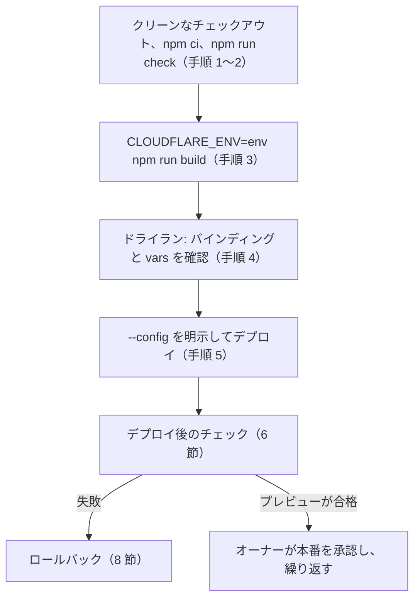

<!-- source: docs/en/DEPLOYMENT.md blob 37bb39aebe6e4d96b14001233afb2529590dc466 -->
[English](../en/DEPLOYMENT.md) | 日本語 · [目次に戻る](README.md)

> この文書は[英語版](../en/DEPLOYMENT.md)の翻訳。内容が異なる場合は英語版が優先する。

# デプロイ手順書

Cloudflare 上のプレビューと本番の Worker について、準備、マイグレーション、ビルド、デプロイ、確認、ロールバックの手順をまとめる。オーナーと、オーナーの承認を受けるためにデプロイを準備する人向けの文書だ。AI の有効化は [AI_ENABLEMENT.md](AI_ENABLEMENT.md)、デプロイしたアプリの運用は [OPERATIONS.md](OPERATIONS.md) にある。

> [!WARNING]
> ログイン、リソースの作成、アカウント設定の変更、デプロイをする手順は、どれもその時点でオーナーの明示的な承認が要る。

コマンドは Phase 6（2026-10-18）に、現行の公式ドキュメントと照らし合わせた（[DECISIONS.md](../working/DECISIONS.md)（英語のみ）「Phase 6 verification log」）。*(要確認)* の印がある項目は文書に書かれていないので、その手順の時点で確かめる。これまでに何をデプロイしたかは 11 節にある。

## 1. 目標の構成

| | 公開 Worker | 管理 Worker |
|---|---|---|
| 設定 | `wrangler.jsonc` | `wrangler.admin.jsonc` |
| 提供するもの | 公開 SPA、読み取り専用 API、AI 説明エンドポイント | 管理 SPA と管理 API |
| 保護 | なし（公開サイト） | Worker レベルの Cloudflare Access（"All traffic"）と、管理 API のすべてのハンドラーでの JWT 検証（ADR-004） |
| D1 | 管理 Worker と同じデータベース。コード上は読み取り専用（ADR-018） | マイグレーションを管理する |
| 任意のバインディング | `AI`、`AI_CLIENT_RATE_LIMITER`（ADR-026）、Durable Object `AI_CLIENT_LIMITER`（ADR-029。AI には必須） | `ADMIN_RATE_LIMITER`（ADR-020） |

環境は `preview`（確認用）と `production` の 2 つで、それぞれ専用の D1 データベースを持つ。名前つきの環境は、その環境が自分の `name` を設定しない限り、`<name>-<environment>` という別の Worker としてデプロイされる:

| 環境 | 公開 Worker | 管理 Worker | D1 データベース |
|---|---|---|---|
| `preview` | `travel-discovery-preview` | `travel-discovery-admin-preview` | `travel-discovery-preview` |
| `production` | `travel-discovery`（`env.production` が `name` を設定。オーナーの判断、2026-10-18） | `travel-discovery-admin`（同様） | `travel-discovery-production` |

- Worker の名前で `workers.dev` の URL（`<worker>.<account subdomain>.workers.dev`）が決まる。
- トップレベルの設定はローカル専用のまま。`npm run dev`、テスト、E2E が使う。
- `wrangler.admin.jsonc` の `env.e2e` はローカルのテスト用で、決してデプロイしない。

## 2. 必要な承認（順番どおり）

1. ダッシュボードでのアカウントのプランの確認（Workers Free。支払い方法が登録されているか）。
2. オーナーの端末からの Cloudflare へのログイン（3.1）。
3. 各 D1 データベースの作成。
4. 設定の変更 C5（3.3）。最初のデプロイの前にコミットする。
5. 各リモートデータベースへのマイグレーションの適用。
6. Cloudflare Zero Trust の有効化と、各管理 Worker の Access ポリシーの作成。
7. 各デプロイ。`preview` が先。
8. 後で AI を有効にするのは別の判断（[AI_ENABLEMENT.md](AI_ENABLEMENT.md)）。

## 3. 初回だけのセットアップ

### 3.1 ログイン
オーナーが自分の端末で実行する。ログインはブラウザーの OAuth で、認証情報はリポジトリではなくユーザーのホームディレクトリに保存される。

```bash
npx wrangler login
```

```bash
npx wrangler whoami
```

デプロイ用の API トークンは作らない。`.dev.vars`、`.env`、リポジトリ内のどのファイルにも決して入れない。Phase 4 の評価用トークンはデプロイ用ではなく、すでに削除してあるはずだ（10 節）。

### 3.2 D1 データベース
環境ごとに 1 つ作る:

```bash
npx wrangler d1 create travel-discovery-preview
```

- 表示された `database_id` を、**両方の**設定の対応する環境に記録する（C5）。ID は秘密情報ではない。
- ローカルのプレースホルダー `local-travel-discovery` を使い回さない。それでデプロイすると、別のデータベースに触れずに失敗する（ADR-018）。
- `travel-discovery-production` は、本番が承認されてから同じ方法で作る。
- `--location`（ロケーションのヒント）は任意。オーナーが選ばない限り指定しない。

### 3.3 設定（C5、ADR-026「Stage 5 preparation decisions」C）
`env.preview` と `env.production` は両方の Wrangler の設定にある（Phase 6、2026-10-18）。それぞれ専用のデータベースと `namespace_id` の値（プレビューは `1001`／`1002`、本番は `2001`／`2002`）を持つ。`env.production` は、トップレベルの Worker 名を保つために `name` も設定する。

名前つきの環境は `vars` とバインディングを引き継がないので、各環境は使うものをすべて宣言する:
- **両方の Worker:**
  - その環境の `database_name` と `database_id` を持つ `d1_databases`（管理の設定は `migrations_dir` も残す）。
  - `"observability": { "enabled": true, "logs": { "enabled": true, "invocation_logs": false } }`。アプリ自身の行だけを残す Workers Logs だ。呼び出しログは、各リクエストの IP アドレス、ヘッダー、位置情報を保存してしまう（[DECISIONS.md](../working/DECISIONS.md)（英語のみ）「Phase 7 verification log」）。
  - `"workers_dev": true` と `"preview_urls": false`。ダッシュボードの設定が黙ってずれないよう、明示的に書く。
  - `upload_source_maps`。
- **公開 Worker:**
  - `ai` バインディング。
  - `vars` の `AI_ASSIST_ENABLED: "false"` と `AI_MODEL: "@cf/google/gemma-4-26b-a4b-it"`。
  - `ratelimits` バインディング `AI_CLIENT_RATE_LIMITER`（`simple: { limit: 5, period: 60 }`）。
  - Durable Object バインディング `AI_CLIENT_LIMITER`（クラス `AiClientLimiter`）と、マイグレーション `v1`（`new_sqlite_classes`）。ローカルで動かすため、トップレベルにも置く（ADR-029）。
- **管理 Worker:**
  - `ratelimits` バインディング `ADMIN_RATE_LIMITER`（推奨 `limit: 120, period: 60`）。
  - `vars` の `ACCESS_TEAM_DOMAIN` と `ACCESS_POLICY_AUD`。秘密情報ではない。3.4 の後でわかり、管理 Worker ごとに違う。
- **レート制限の名前空間:** `ratelimits` のエントリーにはそれぞれ専用の `namespace_id`（正の整数を文字列にしたもの。アカウント内で一意）が要る。同じ ID のバインディングはカウンターを共有するので、プレビューと本番で共有してはならない。

> [!WARNING]
> ローカルの実行に AI の設定を持ち込まない。`ai` バインディングは、`npm run dev` やテストからでも常に Cloudflare に接続する。
> - トップレベルに `ai`、`ratelimits`、AI の変数を決して足さない。
> - `CLOUDFLARE_ENV` にデプロイ環境を設定したまま `npm run dev` や `npm run dev:admin` を決して動かさない。環境向けのビルドの後に `npm run preview` も使わない。どちらもその環境の `ai` バインディングを使ってしまう。
> - `dist/` と `dist-admin/` をローカルの設定に戻すには、`CLOUDFLARE_ENV` なしで `npm run build` を実行する。

C5 のチェック（ローカル、ログイン不要。`env.preview` について 2026-10-18 にすべて合格）:
- トップレベルのビルド出力（`dist/worker/wrangler.json`、`dist-admin/admin_worker/wrangler.json`）が、定義した環境の一覧以外は変わらない。
- `CLOUDFLARE_ENV=preview npm run build` が、期待どおりに平たくした設定を書き出す。
- `npm run check` と `npm run test:e2e` が通る。
- `npm run dev` がリモートバインディングの警告を出さない。

### 3.4 各管理 Worker の Cloudflare Access
管理 Worker には、Access なしで決して到達できてはならない。一方で、Worker レベルの Access は存在する Worker にしかかけられない。だから最初のデプロイでは URL を持たせない:

1. 管理 Worker の最初のデプロイは、その環境で `"workers_dev": false`（と `"preview_urls": false`）にして、URL を持たせない。そうした Worker でも Access タブは使える（2026-10-18 に確認）。
2. 必要なら Zero Trust を有効にし（ダッシュボード）、チーム名を選ぶ。Free プランの席数の上限とログイン方法（One-time PIN など）はそこで確かめる *(要確認: 文書に書かれていない)*。
3. Worker を保護し、ポリシーをオーナーだけに絞る:
   1. Workers & Pages → 管理 Worker → Access → "Protect this Worker behind Access" → スコープ **All traffic**。
   2. クイックセットアップで選べるのは "Cloudflare account" と "Email domain" のポリシーだけ（2026-10-18 に確認）。**Cloudflare account**（このアカウントのメンバーだけ）を選んで適用する。
   3. Zero Trust → Access controls → Policies を開き、生成された再利用可能なポリシー（`<worker> - Production`）を編集する。Include ルールを、オーナーの完全なアドレスを指定した **Emails** セレクターに変える。
   4. 公開のメールサービスの "Email domain"（そこのすべてのアドレスを通してしまう）、"Everyone" セレクター、"Login Methods: One-time PIN" の Include ルール（PIN を受け取れる人なら誰でも通してしまう）は決して選ばない。
4. AUD タグとチームドメインを、その環境の `ACCESS_POLICY_AUD` と `ACCESS_TEAM_DOMAIN` にコピーする。`"workers_dev": true` にして、コミット、再ビルド、再デプロイする。この 2 つの値がないと、管理 API のリクエストはすべて 403 になる（失敗時は拒否）。
   - AUD タグ: Zero Trust → Access controls → Applications → その Worker のアプリケーション。文書では Configure → Additional settings → "Application Audience (AUD) Tag" とされているが、ダッシュボードでは違うことがある。
   - チームドメイン: `https://<team>.cloudflareaccess.com`。Zero Trust → Settings で見るか、Zero Trust を有効にしたときのチーム名から導く。
5. Access タブやポリシーを変えたら、必ずスコープ（**All traffic**）と、Worker の `workers.dev` の URL（Settings → Domains & Routes）の両方を確かめる。2026-10-18 には、スコープが "Previews only" になっていたことと、Access の設定を保存した後に URL が無効になっていたことが一度ずつあった。
   - `workers_dev` を有効にしたデプロイの直後に、`/` と `/api/admin/me` に認証なしのリクエストを送る。どちらも `https://<team>.cloudflareaccess.com/...` にリダイレクトしなければならない。
   - `/` が 200 を返したら、すぐに `workers_dev: false` で再デプロイする。
6. 管理用のホスト名に当たる、Bypass ポリシーつきのホスト名／パスの Access アプリケーションを作らない（ADR-004 の不変条件 4）。アカウント全体の Worker 保護も使わない。公開サイトまで保護してしまう。

本番の管理 Worker でも同じことを繰り返す。こちらは専用の Access 設定と AUD を持つ。

### 3.5 秘密情報
今の Worker には秘密情報が要らない。AI バインディングは何も要らず、Access の値は秘密ではない。後で秘密情報を足すなら、その環境の Worker を対象に `npx wrangler secret put <NAME>` で設定するか、ダッシュボードで設定する。ファイル、`.dev.vars`、`.env` には決して入れない。デプロイで秘密情報が消えることはない。

## 4. データベースのマイグレーション
マイグレーションは管理の設定からだけ適用する。プレビューが先:

```bash
npx wrangler d1 migrations apply travel-discovery-preview --remote --env preview --config wrangler.admin.jsonc
```

- Wrangler は未適用のマイグレーションを並べ、確認を求め、適用する前にバックアップを取る。
- プレビューのチェックが通ったら、`travel-discovery-production` と `--env production` で同じことをする。
- 本番に適用する前に、復元ポイントを記録する: `npx wrangler d1 time-travel info travel-discovery-production`。
- `npx wrangler d1 export travel-discovery-production --remote --output <file>` で SQL のエクスポートも取れる。本番のエクスポートには公開済みのコンテンツが入るので、リポジトリの外に置く。
- スキーマの変更は、前にデプロイしたコードと後方互換にする。コードをロールバックしても、データベースは戻らない（8 節）。
- `db/seed/dev.sql` はローカルのテストデータだ。プレビューのデータベースに読み込むかは、その手順の時点でのオーナーの判断 *(要確認)*。本番には決して読み込まない。本番のコンテンツは管理コンソールから入れる。

## 5. ビルドとデプロイ



1. ビルドするマシンに `.dev.vars` がないか、ローカルのテスト値だけが入っていることを確かめる。ビルドはそれを `dist/` と `dist-admin/` にコピーする（[DEVELOPMENT.md](DEVELOPMENT.md)）。
2. デプロイするコミットをチェックアウトし、`git status` がクリーンな状態で `npm ci` と `npm run check` を実行する。
3. その環境向けに両方の Worker をビルドする:

   ```bash
   CLOUDFLARE_ENV=preview npm run build
   ```

   - `CLOUDFLARE_ENV` はビルド時に Vite プラグインが読む。`wrangler deploy` は無視する。
   - ビルドは、その環境向けに平たくした設定を書き出す。
   - `npm run build` は型チェックとバンドルのチェックも実行する。

4. デプロイせずに、何がデプロイされるかを確かめる（ログイン不要。2026-10-18 に確認）:

   ```bash
   npx wrangler deploy --dry-run --config dist/worker/wrangler.json
   ```

   ```bash
   npx wrangler deploy --dry-run --config dist-admin/admin_worker/wrangler.json
   ```

   - 出力のバインディングと `vars` を確かめる。ドライランは Worker の名前を出さない。名前は同じ `wrangler.json` の `name` 項目にある。
   - デプロイは必ず上の `--config` のパスを明示する。ビルドはリダイレクト用のファイルも書き出す。公開のビルドは `.wrangler/deploy/config.json`、管理のビルドは `admin/.wrangler/deploy/config.json` だ（管理の Vite のルートが `admin/` のため）。2026-10-18 に Wrangler 4.151.1 で確認したこと:
     - リポジトリのルートでただ `npx wrangler deploy` を実行すると、リダイレクトに従って**公開 Worker だけ**をデプロイする。
     - `--config <生成された wrangler.json>` を指定すると、リダイレクトは使われない。
     - `--cwd admin` は失敗する。リダイレクト用のファイルがユーザーの設定の隣にないからだ。
5. 同じコマンドから `--dry-run` を外して、各 Worker をデプロイする。初回のセットアップでは管理が先（3.4）、普段はプレビューが先。
6. 6 節を実行し、本番の承認が出たら `production` で繰り返す。

## 6. 各デプロイ後のチェック
下の認証なしのチェックは自動化してある:

```bash
node scripts/check-deployment.mjs <account subdomain> <preview|production>
```

管理 Worker をデプロイした後は `--watch-admin 120` を足す。日々の監視、定期チェック、インシデント対応は [OPERATIONS.md](OPERATIONS.md) にある。

次の項目は、デプロイした Worker でしか確かめられない（[DECISIONS.md](../working/DECISIONS.md)（英語のみ）の「Admin authentication status」と検証ログより）:
- 管理用のすべての URL（`workers.dev`、ルート、カスタムドメイン）が、未ログインなら Access のログインにリダイレクトする。管理の静的アセットにも、ログインなしでは届かない。
- ログインすると、管理 API がリクエストを受け付ける。`Cf-Access-Jwt-Assertion` ヘッダーが静的アセットのルーターを通って Worker に届き、トークンの検証（RS256、発行者、オーディエンス）が通る。
- 両方の Worker で Version URL が無効になっている（デプロイ済みのバージョンは `npx wrangler versions list --name <worker>` で一覧できる）。
- 公開 Worker と管理 Worker が同じ D1 のデータを見ている（管理で公開し、公開 API で確かめる）。
- 公開サイトが `ja`、`en`、`es` で最後まで動く。AI が無効の間、AI のトグルは「利用できません」の通知を出す。
- Rate Limiting のバインディングがエラーなくデプロイできる（アカウントで使えるかは未確認、ADR-026）。デプロイで拒否されたら、その環境から外して結果を記録し、AI は無効のままにする（ADR-026 A、前提条件 2）。
- Workers Logs に、AI エンドポイントの `disabled` の結果の行が、アドレスや回答なしで出ている。

## 7. AI の有効化（別途承認）
AI の有効化には専用の手順書がある: [AI_ENABLEMENT.md](AI_ENABLEMENT.md)。以前の小節は次の場所に移った:

- 前提条件と一般的な手順: [AI_ENABLEMENT.md](AI_ENABLEMENT.md) 1 節。
- 7.1 プレビューでの試行: [AI_ENABLEMENT.md](AI_ENABLEMENT.md) 2 節。
- 7.2 AI を無効にしたままのリミッターの確認: [AI_ENABLEMENT.md](AI_ENABLEMENT.md) 3 節。
- 7.3 本番での AI の有効化: [AI_ENABLEMENT.md](AI_ENABLEMENT.md) 4 節。

## 8. ロールバック
- **コード:** `npx wrangler rollback <VERSION_ID> --name <worker>`、またはダッシュボード（Workers & Pages → その Worker → Deployments → Rollback）。
  - すぐに反映され、直近の 100 バージョンまで戻せる。
  - バインドしたリソースは変わらない。データベースは今のスキーマとデータのまま。
  - 静的アセットもバージョンと一緒に戻る。2026-10-25 に公開のプレビュー Worker で確認した（[DECISIONS.md](../working/DECISIONS.md)（英語のみ）「Phase 10 verification log」）。配信される `index.html` とクライアントのバンドルは、どちらの向きでも約 20 秒以内に戻し先のバージョンのものに切り替わり、もう一方のバージョンのバンドルは配信されなくなった。
  - 代わりに、前の正常なコミットのビルドを再デプロイしてもよい。
- **データ:** `npx wrangler d1 time-travel restore <database> --timestamp <unix|RFC3339>`（または `--bookmark`）で、Workers Free なら 7 日以内の時点に戻せる。これは**破壊的**だ。すべてのデータを置き換え、実行中のクエリを取り消し、元に戻すためのブックマークを出力する。復元のたびにオーナーの承認を得る。
- **AI の問題:** ロールバックではなく停止スイッチを使う（[AI_ENABLEMENT.md](AI_ENABLEMENT.md)）。

## 9. 無料枠の前提（デプロイ前に再確認する）
2026-10-18 に確認した（[DECISIONS.md](../working/DECISIONS.md)（英語のみ）「Phase 6 verification log」）。無料枠と上限は変わる。
- **Workers Free:** アカウントあたり 1 日 100,000 リクエスト（超えると Error 1027、00:00 UTC にリセット）、リクエストあたり CPU 10 ms。静的アセットへのリクエストは Worker を動かさない（[DECISIONS.md](../working/DECISIONS.md)（英語のみ）の Phase 0 のログ）。https://developers.cloudflare.com/workers/platform/limits/
- **D1 Free:** アカウント全体で 1 日 500 万行の読み取りと 10 万行の書き込み（超えると 00:00 UTC までクエリが `D1_ERROR` で失敗）、データベースあたり 500 MB、Time Travel は 7 日。https://developers.cloudflare.com/d1/platform/pricing/
- **Workers AI:** 1 日 10,000 Neurons まで無料。Workers Free では、それを超えると課金されずに失敗する。https://developers.cloudflare.com/workers-ai/platform/pricing/
- **Workers Logs:** Free では 1 日 200,000 イベント、保持は 3 日。
  - **2026-12-01 から Workers Logs は Cloudflare Observability の料金体系に移る**: Free では 1 日 0.5 GB の取り込みと 7 日の保持。上限に達すると取り込みが止まり、課金はされない。
  - 2026-10-19 に確認し、2026-10-24 と 2026-10-25 にも再確認して変わりなし（[DECISIONS.md](../working/DECISIONS.md)（英語のみ）の「Phase 7 verification log」「Phase 8 verification log」「Phase 9 verification log」）。
  - 2026-10-24 に読んだアカウントの 1 日の量は、多くても上限の数パーセント。変更後の最初の確認は日付つきのタスクにしてある（[OPERATIONS.md](OPERATIONS.md) 3 節と 7 節）。
  - https://developers.cloudflare.com/workers/observability/logs/workers-logs/、https://developers.cloudflare.com/observability/pricing/
- **Rate Limiting バインディング:** Workers Free で使えるか、いくらかは文書にない。承認を得たプレビューのデプロイでだけ確かめられる。https://developers.cloudflare.com/workers/runtime-apis/bindings/rate-limit/
- **Cloudflare Zero Trust Free:** 席数の上限、料金、ログイン方法はプランのページに書かれていない。ダッシュボードで確かめる。https://www.cloudflare.com/plans/zero-trust-services/

## 10. 最初のデプロイ前の手作業のチェック（オーナー）
- [ ] デプロイするコミットで `npm run check` と `npm run test:e2e` が通り、push 後に GitHub の CI が成功している。
- [ ] `git status` がクリーンで、`.dev.vars`、`.env`、`.ai-eval/`、`dist*/` の中身がコミットされていない。
- [ ] Chrome で、公開のクイズと管理画面の旅行先フォームをキーボードだけで操作でき、フォーカスが見える。
- [ ] クイズ、結果、言語切り替えをスクリーンリーダー（VoiceOver）でざっと確かめる。
- [ ] スマートフォン大とデスクトップのウィンドウで、ライトモード、ダークモード、200% ズームを確かめる。
- [ ] 動きを減らす設定で、操作を妨げるアニメーションがない。
- [ ] コンテンツの確認: 費用に基準、出典、日付が出ている。リアルタイム価格と受け取れる言い回しがない。公開したコンテンツには少なくとも `ja` と `en` の翻訳がある。
- [ ] 外部の検索リンクが、新しいタブでサービスのトップページだけを開く。
- [x] Stage 5 の評価用 API トークンをダッシュボードで削除した（オーナー、2026-10-24）。
- [x] Gemma の利用規約と禁止用途のポリシーを確認した（AI を有効にする前。オーナー、2026-10-24）。
- [ ] コミットの作成者のメールアドレスが、想定するリポジトリの公開範囲で問題ない（[PUBLIC_RELEASE.md](../working/PUBLIC_RELEASE.md)、英語のみ）。

## 11. デプロイの履歴

Phase 6（2026-10-18）時点の状態と、その後のデプロイ。詳細は [DECISIONS.md](../working/DECISIONS.md)（英語のみ）の検証ログにある。

**プレビュー（2026-10-18）:**
- プレビューの D1 データベース `travel-discovery-preview` を作った（リージョン APAC）。`env.preview`（C5）を、その ID とともに両方の Wrangler の設定に入れてある。
- マイグレーション `0000`〜`0001` を適用し、`db/seed/dev.sql` を読み込んだ（オーナー承認済み、プレビューだけ）。
- 3.4 の Access 設定のため、管理 Worker `travel-discovery-admin-preview` を `workers_dev: false` で一度デプロイした（バージョン `be458778`。Wrangler は "No targets deployed" と報告したので、URL はない）。
- その後オーナーが Zero Trust と Worker レベルの Access（"All traffic"）を有効にし、生成された再利用可能なポリシーを、オーナーのアドレスを指定した **Emails** の Include ルールに変えた。管理の設定の `env.preview` に Access の値がある。
- インシデント: `workers_dev: true` でデプロイしたとき、管理 SPA が約 2 分間 Access なしで見えた（API は 403 のままだった）。`workers_dev: false` に戻した。Access のスコープが "Previews only" になっていたので、"All traffic" に戻した（[DECISIONS.md](../working/DECISIONS.md)（英語のみ）「Phase 6 verification log」）。
- その後、管理 Worker を再デプロイし（バージョン `8bc1cc2c`）、Access の内側にあることを確かめた。認証なしのリクエストは Access のログインにリダイレクトされ、オーナーはログインして管理 UI を使えた（[DECISIONS.md](../working/DECISIONS.md)（英語のみ）「Admin authentication status」）。
- 公開 Worker `travel-discovery-preview` をデプロイした（バージョン `ea2abe3d`、AI 無効）。Workers Logs のチェック以外の 6 節のチェックに合格した（[DECISIONS.md](../working/DECISIONS.md)（英語のみ）「Phase 6 verification log」）。

**本番（2026-10-18）:**
- 本番の D1 データベース `travel-discovery-production` を作った（リージョン APAC）。`env.production` を、その ID とともに両方の Wrangler の設定に入れてある。
- 空のデータベースの Time Travel のブックマークを記録してから、マイグレーション `0000`〜`0001` を適用した（18 テーブル、コンテンツの行なし、シードデータなし）。
- Access 設定のため、本番の管理 Worker `travel-discovery-admin` を `workers_dev: false` で一度デプロイした（バージョン `86694c6e`、"No targets deployed"）。
- オーナーが Access を設定した（All traffic、Emails のポリシー、スコープを再確認）後、`workers_dev: true` で再デプロイした（バージョン `1b184825`）。確かめたすべてのパスが、最初のリクエストから 2 分後まで Access のログインにリダイレクトした。オーナーはログインして空の管理画面の一覧を見て、`/api/admin/me` はオーナーのアドレスを返した。
- 本番の公開 Worker `travel-discovery` を、空のデータベースでデプロイした（バージョン `87d11262`、AI 無効）。プレビューと同じ `curl` のチェックに合格した（コンテンツはまだなく、旅行先も質問も 0）。

**その後（2026-10-24）:**
- 4 つの Worker すべてを、Workers Logs の呼び出しログを無効にして再デプロイした（プレビュー `def4b576`／`e45a9449`、本番 `f73d57c0`／`07a234a3`）。両方の管理 Worker の Access のリダイレクトを含め、同じチェックに合格した（[DECISIONS.md](../working/DECISIONS.md)（英語のみ）「Phase 7 verification log」）。
- 管理 Worker をコンテンツのインポート機能つきで再デプロイした（プレビュー `3e2b9f30`、本番 `9d51e1a4`）。
- `content/initial-v1.json` をプレビューと本番にインポートした。本番はその時点で、公開済みの旅行先 18 件と質問 12 問になった（ADR-028）。
