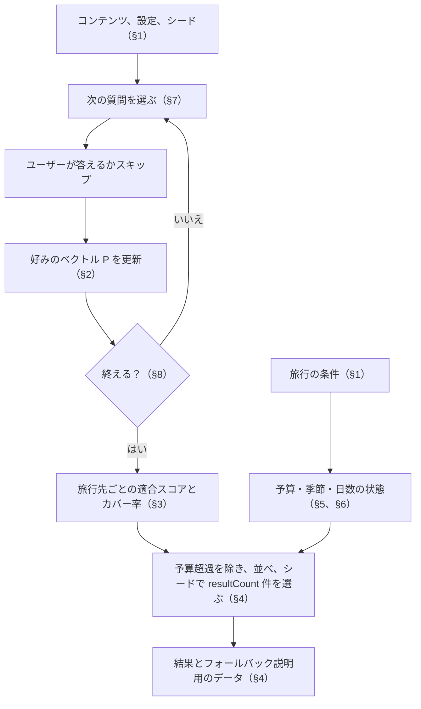

<!-- source: docs/en/DIAGNOSTIC_ALGORITHM.md blob acb8bf23ce60195e4e27992a51ea123ccfabb06e -->
[English](../en/DIAGNOSTIC_ALGORITHM.md) | 日本語 · [目次に戻る](README.md)

> この文書は[英語版](../en/DIAGNOSTIC_ALGORITHM.md)の翻訳。内容が異なる場合は英語版が優先する。

# 診断アルゴリズム — Travel Discovery

決定的なクイズと順位付けのエンジン（Phase 2）の仕様。実装は `domain/diagnosis/` にあり、この文書と一致しなければならない。`domain/diagnosis/*.test.ts` のテストは、下の例をコードにしたものだ。判断と理由は [DECISIONS.md](../working/DECISIONS.md)（英語のみ） ADR-021、ADR-031、ADR-037 に記録してある。

エンジンは純粋な TypeScript で、React、データベース、Cloudflare のバインディング、ネットワーク、AI を使わない。同じコンテンツ、回答、条件、設定、シードを渡せば、いつも同じ出力を返す。

## 全体のつながり

クイズのループは、終了ルールが止めるまで質問を選び続ける。その回答をもとにスコアを出し、順位を決める。旅行の条件は注記と除外に使うだけで、適合スコアは変えない。



## 1. 入力

- **コンテンツ**: 属性、質問（カテゴリー、タイプ、優先度、選択肢、選択肢の効果つき）、旅行先（属性スコア、おすすめの日数、適した月、費用の概算つき）。
  - エンティティは安定したスラッグで、選択肢は `(質問のスラッグ, 選択肢の value)` で見分ける。
  - 状態の項目も渡すので、無効なコンテンツはエンジン自身が無視できる。
- **回答**: `{ question, options[] }` の順序つきリスト。`options` が空なら、その質問は表示されてスキップされたということ。
- **旅行の条件**（すべて任意）: 旅行日数、旅行する月（1〜12）、予算 `{ amount, currency }`。
- **設定**: `minQuestions`、`targetQuestions`、`maxQuestions`、`resultCount`（`server/admin/settings.ts` で検証）。
- **シード**: クイズのセッションごとに選ぶ符号なし 32 ビット整数（Phase 3 ではクライアントが選ぶ）。

### 使えるコンテンツ
- 属性: `status = active`。
- 質問: `status = published` で、カテゴリーが `active`、`active` な選択肢が 2 つ以上あり、有効な選択肢の少なくとも 1 つが使える属性にゼロ以外の効果を持つ。最後の条件を満たさない質問はスコアのシグナルを持たないので飛ばす（`questionsWithoutEffects` として報告する）。
- 選択肢: `status = active`。無効な属性への効果は無視する。
- 旅行先: `status = published`。

## 2. 好みのベクトル

使える属性 `a` ごとに、好み `P[a]` は、回答した質問の寄与 `c_q[a]` を足し合わせたものだ。

**回答の正規化。** 不正な回答は例外を投げずに無視し、理由コードつきで報告する:
- 質問は使えるものでなければならない。そうでなければ `unknown_question`。
- 1 つの質問については最初の回答だけを数える。2 つ目以降は `duplicate_question`。
- 選ばれた値は重複を除き、その質問の有効な選択肢でない値は取り除く。
- 選択肢が 1 つも残らないとき: 回答はスキップとして数える（値が渡されていたら `no_valid_option`）。
- 選択肢が 2 つ以上残った `single_choice`: `too_many_options`（無視する）。

**スキップした質問と未回答の質問。** これらがスコアをどれかの旅行先に引き寄せることはない:
- スキップした回答（`options` が空、または正規化の後に選択肢が残らない）と、無視した `too_many_options` の回答は、`P` に何も足さない。重み 0 の選択としても扱わない。
- ただし、その質問は選択と問題数（§7、§8）のうえでは表示済みとして数える。
- 一度も表示されなかった質問は何も足さない。

**寄与。** 残った選択肢の集合を `S`、`k = |S|` とする。

```
c_q[a] = ( Σ_{o ∈ S} w_o[a] ) / k
```

- `w_o[a]` は選択肢 `o` の `a` への効果の重み（−5〜5 の整数）。**選択肢が `a` への効果を持たなければ 0** とする。
- 分母は常に `k` で、`a` への効果を持たない選択肢も数える。こうすると、選択肢をいくつ選んでも、1 つの質問の影響は単一の選択肢の最大の効果を超えない。
- `single_choice` の回答は `k = 1` の場合にあたる。

例（`multiple_choice`、選択肢 A `{nature +3, beach +2}`、B `{nature +1}`、C `{food +3}`）:

| 選んだもの | nature | beach | food |
|---|---|---|---|
| A | 3 | 2 | 0 |
| A, B | (3+1)/2 = 2 | (2+0)/2 = 1 | 0 |
| A, C | (3+0)/2 = 1.5 | (2+0)/2 = 1 | (0+3)/2 = 1.5 |

## 3. 旅行先の適合スコア

旅行先の属性スコアは 0〜5 の整数だ。中間のスコアが中立になり、マイナスの好みが高いスコアを減点するように、中心をずらして使う:

```
x_d[a] = (2 · score_d[a] − 5) / 5        ∈ [−1, 1]
x_d[a] = 0                               when the destination has no score for a
S_d    = Σ_a P[a] · x_d[a]
fit_d  = 50 + 50 · S_d / Σ_a |P[a]|      ∈ [0, 100]
fit_d  = 50                              when Σ_a |P[a]| = 0 (no preference signal)
```

例: `P = {nature: 2, beach: 1}`。
- X が `nature 5, beach 1` のとき: `x = (1, −0.6)`、`S = 2 − 0.6 = 1.4`、`fit = 50 + 50 · 1.4 / 3 ≈ 73.33`。
- Y が `nature 2, beach 5` のとき: `x = (−0.2, 1)`、`S = −0.4 + 1 = 0.6`、`fit = 50 + 50 · 0.6 / 3 = 60`。

**カバー率**は、シグナルのある属性（`P[a] ≠ 0`）のうち、その旅行先がスコアを持つものの割合だ。シグナルがなければ、使える属性のうち旅行先がスコアを持つものの割合になる。スコアがない属性は 0 として扱わず、カバー率を下げる。

適合スコアは現在のコンテンツデータに対する相対的な適合度で、確率ではない。UI には `round(fit)` を表示し、順位付けには丸める前の値を使う。

## 4. 順位付けと同点の扱い

1. 使える旅行先を取る。
2. 予算、季節、日数の状態を計算する（§5〜§6）。
3. 予算の状態が `over` の旅行先を除く（唯一のハードフィルター）。
4. `fit` の降順、次に `coverage` の降順、次にスラッグの昇順（コード単位の順で、ロケールに依存しない）で並べる。
5. セッションのシードでそのうち `resultCount` 件（3〜5）を選び（下の「結果の変化」）、手順 4 の順で返す。順位は表示位置の 1、2、… とする。
   - 足りなければ、残った分を通知 `fewer_than_requested` つきで返す。1 件もなければ通知 `no_eligible_destinations`。
   - `Σ|P| = 0` のときは通知 `no_preference_signal` を足す。

予算、季節、日数が `fit` を変えることはない。

### 結果の変化
いちばん合う旅行先は必ず最初に出す。残りの枠は、ほぼ同じくらい合う旅行先から、クイズのセッションのシードで選ぶ（ADR-037）。そのため同じ回答でも、クイズごとに出る旅行先が変わりうる。並び順とすべての適合度は決定的なままだ。

1. **帯。** 手順 4 の順で上位 **12** 件のうち先頭を除いた旅行先で、`fit` が最良の適合度から **10** 点以内のもの。
2. 帯の件数が空き枠（`resultCount − 1`）以下なら、変化を入れない場合と同じく先頭から `resultCount` 件を返し、引き直しは出さない。
3. そうでなければ、帯の各旅行先にキー `ln(u) / w` を与える。`u` は (0, 1) の数で、シード、引き直しの番号、スラッグから作る。`w = 1 + (fit − floor) / 10` で、`floor` は帯の下限だ。最良の適合度の旅行先は、下限の旅行先の 2 倍選ばれやすい。空き枠にはキーの大きい順に入れる（重みつきの非復元抽出）。
4. **引き直し。** 「ほかの候補を見る」で引き直しの番号 `k` が 1 増える（最大 20）。`k` 回目の引き直しでは、`0…k−1` 回目にまだ出ていない旅行先を、出た旅行先より先に選ぶ。だから帯の旅行先が一巡するまで、同じものは出ない。回答が変わったときと新しいクイズを始めたときは、番号を 0 に戻す。
5. 選んだ旅行先は手順 4 の順で返す。だからカードに出る適合度は、下に行くほど上がることはない。

`u = (mix32(mix32(seed ⊕ 0x3c6ef372 ⊕ (k + 1)·0x9e3779b9) ⊕ fnv1a(slug)) + 0.5) / 2³²` で、32 ビットの FNV-1a と MurmurHash3 の仕上げ関数 `mix32` を使う（`domain/diagnosis/variety.ts`）。ソルトは、同じシードを使う質問の選択（§7）と抽選を独立させるためのものだ。旅行先の `u` はシード、引き直しの番号、スラッグだけで決まるので、旅行先を足したり外したりしても、ほかの旅行先のキーは変わらない。

値は `content/initial-v10.json` での診断のシミュレーションから選んだ（ADR-037）。どのクイズでも最良の旅行先が最初に出る。1 つの回答に対して、シード 30 通りでおよそ 14〜20 通りの結果の組み合わせが出る。表示する結果の平均の適合度は、先頭 5 件より約 1 点低い。変化を入れても、旅行先ごとの出る頻度はほとんど変わらない（ケープタウンは 43% から 38%）。よく出る旅行先は、たいてい上位の近くにあるからだ。

### フォールバック説明用のデータ
各結果は、UI が決定的でローカライズした説明（AI なし）を組み立てるための構造化データを持つ:
- ユーザーが望む属性（`P[a] > 0`。同点はスラッグ順）のうち、正の寄与 `P[a] · x_d[a]` が大きい上位 3 つ
- 最大 2 つの**際立つ強み**（下記）
- 予算、季節、日数の状態
- カバー率

UI はこれらを、旅行先の人が書いた概要・見どころと、メッセージカタログのテンプレートに組み合わせる。

「合う理由」に挙げるのは、ユーザーが望んだものだけだ。ユーザーが嫌う属性を旅行先が持たない（`P[a] < 0` で低スコア）場合も `fit` は上がるが、合う点としては挙げない。例: `beach` が −3 のとき、`beach 0` の旅行先は `S_d` で `+3` を得るが、「ビーチ」とは表示しない。このリストは任意の AI 説明には送らない（Phase 22 から、ADR-026）。

**際立つ強み**は、表示する結果どうしの違いを示す。上位の属性は、ユーザーが望んだ少数の属性で占められ、結果の間で同じになりやすいからだ。表示する各結果について、次の両方を満たす属性を強みとする:
- ユーザーが望み（`P[a] > 0`）、旅行先にスコアがある
- スコアが、表示する結果の平均スコアより **0.75** 点以上高い。つまり `x_d[a] − mean(x[a]) ≥ 0.3`。平均では、スコアがない場合を適合度と同じく `x = 0` として数える

挙げるのは最大 2 つで、`P[a] · (x_d[a] − mean(x[a]))` の大きい順、同点はスラッグ順に並べる。結果が 1 件だけなら強みはない。強みは説明用のデータにすぎず、`fit`、カバー率、順位を変えない。AI にも送らない。

例: 表示する結果の `nature` のスコアが 5、4、4、4、4（平均 4.2）なら、最初の結果は平均より 0.8 高いので `nature` が強みになる。ほかの結果は平均より低い。0.75 という幅は、`content/initial-v8.json` での診断のシミュレーションから選んだ（ADR-035）。

## 5. 予算の比較

予算の比較は独立したモジュール（`budget.ts`）で、スコアリングには含めない。

- ユーザーの予算は**上限**で、1 人あたり、旅行全体、**国際線の航空券を除く**金額だ。通貨は `JPY`、`USD`、`EUR`（既定は `JPY`）。
- 旅行先が持てる費用の概算は、通貨ごとに最大 1 件。比較には、通貨が予算の通貨と同じで、**かつ**対象範囲が `per_person_excluding_international_flights` の概算を使う。通貨の換算はしない。
- 旅行全体の概算の範囲:
  - `per_trip`: `[min, max]`。
  - `per_day` で旅行日数 `n` があるとき: `[min · n, max · n]`。
  - `per_day` で旅行日数がないとき: `[min · recommendedDaysMin, max · recommendedDaysMax]`。おすすめ日数の上下どちらかがなければ、状態は `unknown`。

| 状態 | 条件 | 扱い |
|---|---|---|
| `not_applicable` | 予算の入力なし | 残す |
| `unknown` | 費用の概算がない、または `per_day` の範囲を日数で掛けられない | 残して印をつける |
| `incomparable` | 概算はあるが、予算の通貨と対象範囲に合うものがない | 残して印をつける |
| `within` | 範囲の上限 ≤ 予算 | 残す |
| `partial` | 下限 ≤ 予算 < 上限 | 残す |
| `over` | 下限 > 予算 | **除外** |

旅行先を除くのは、考えられる最も安い費用でも予算を超えるときだけだ。除外の判定には概算の安い側を使い、旅行日数がないときは最も短いおすすめの滞在日数を使う。下限が予算とちょうど同じなら `over` ではない。

後で通貨や換算の方法を足すときは、概算を足すか、概算を選ぶ手順を差し替える。スコアリングと順位付けには影響しない。

## 6. 季節と日数（注記だけ）

どちらの状態も、旅行先を除いたり順序を変えたりしない。

- **季節**: 旅行先は適した月（1〜12）を持つか、何も持たない。旅行する月 `M` があるとき:
  - `M` がすべて適した月 → `in_season`
  - 一部 → `partly_in_season`
  - どれも違う → `off_season`
  - 旅行先にデータがない → `unknown`
  - 旅行する月がない → `not_applicable`
- **日数**: 旅行日数 `n` があるとき:
  - `n < recommendedDaysMin` → `shorter_than_recommended`
  - `n > recommendedDaysMax` → `longer_than_recommended`
  - 上下どちらもない → `unknown`
  - それ以外 → `within_recommended`
  - 旅行日数がない → `not_applicable`

## 7. 質問の選択

選択は、コンテンツ、それまでの回答、設定、シードだけで決まる純粋関数だ。

**候補**: まだ回答していない（スキップも回答に含める）使える質問。

候補 `q` の**重み**:

```
weight_q = priorityWeight_q · 1 / (1 + askedInCategory_q) · novelty_q
novelty_q = 2 if q has an effect on any attribute with P[a] = 0, else 1
```

- `askedInCategory_q` は、`q` のカテゴリーですでに回答した質問の数。カテゴリーの係数がカテゴリーのバランスを取る。
- 新規性の係数が適応のルールだ。それまでの回答から見て、ユーザーがまだ示していない好みについての質問を優先する。

**判別力**（Phase 15 から。[DECISIONS.md](../working/DECISIONS.md)（英語のみ） ADR-031）を各重みに掛ける。回答によって、いま有力な旅行先を分けられる質問ほど選ばれやすくなる:

```
weight'_q = weight_q · d_q
d_q       = mean over the active options o of q of  σ_{d ∈ pool} ( Σ_a w_o[a] · x_d[a] )
pool      = every usable destination                      when Σ_a |P[a]| = 0
            the top 2 · resultCount destinations by §4     otherwise (no budget filter)
```

- `σ` は母標準偏差。`x_d[a]` は §3 の中心をずらしたスコア（旅行先にその属性のスコアがなければ 0）。
- 比較対象の旅行先（pool）は §4 の順に並べるが、旅行の条件は考えない。だから質問の選択は旅行の条件に左右されない。
- `d_q = 0` の質問は比較対象の旅行先を分けられない。重みが正の候補がほかにある間は選ばれない。
- すべての候補の weight' が 0 のとき（旅行先がない場合など）は、判別力を掛けない重みを使う。

例: 旅行先 X（`a1, a2` について `x = (1, −1)`）と Y（`x = (−1, 1)`）があり、質問の選択肢が `p {a1: 2}` と `n {a2: 1}` だとする。`p` の値は `(2, −2)` で `σ = 2`、`n` の値は `(−1, 1)` で `σ = 1` なので、`d = 1.5`。どちらの旅行先もスコアを持たない属性にだけ効く質問は `d = 0` になる。

**抽選**: 候補をスラッグ順に並べ、ステップごとの乱数 `r ∈ [0, 1)` を使って、重みに比例する確率で 1 つ選ぶ:

```
stepSeed = (seed XOR imul(step + 1, 0x9E3779B9)) >>> 0      step = number of questions already shown
r        = first output of mulberry32(stepSeed)
```

各ステップの乱数は `(seed, step)` から導く。だから前のステップが乱数をいくつ使ったかに関係なく、シードと回答だけから系列を再現できる。シードが違えば質問の組み合わせも変わる。

## 8. 終了ルール

`limit = min(targetQuestions, maxQuestions)`。

- 表示済みの質問の数が `limit` に達したら、理由 `target_reached` で終える。表示済みとは、回答したかスキップしたもので、不明な回答と重複した回答は数えない。
- 候補が残っていなければ、理由 `no_more_questions` で終える。回答した数が `minQuestions` より少なければ、UI がはっきりしたメッセージを出せるように、結果に `insufficientQuestions` の印をつける。
- それ以外なら、抽選した質問を出す。

つまり `maxQuestions` は絶対の上限だ。候補が尽きた後は、`minQuestions` は質問を続ける理由にならない。

### 早期終了: 評価したが採用しない
候補が尽きない限り、クイズはいつも `limit` 問を出す。安定性による終了ルールを Phase 15 で評価し、採用しなかった（ADR-031）:
- **評価したルール。** 表示した質問が `minQuestions` 問以上になった後、上位 `resultCount` 件の集合が直近の回答で変わらず、順位 `resultCount` と `resultCount + 1` の適合度の差が十分大きければ終える。
- **結果。** 仮想の回答者によるシミュレーションでは、平均で 0.1〜0.8 問早く終わるだけだった。しかも、結果が回答者の理想の旅行先と合う度合いが下がった。数値は [DECISIONS.md](../working/DECISIONS.md)（英語のみ）の「Phase 15 verification log」にある。

## 9. 制約

- 適合スコアは、人が整えた属性スコアと選択肢の重みにすべて依存する。実際の旅行者の結果に照らして検証したものではない。
- 換算をしないので、予算の通貨で人が整えた概算がない旅行先は、そのユーザーには `incomparable` と表示される。
- 季節は月単位で、旅行先の中の地域ごとの気候の違いは表さない。
- 浮動小数点の計算は、同じ入力なら決定的だ。属性と候補はスラッグ順に処理するので、順位付けは入力の配列の並び順に左右されない。
